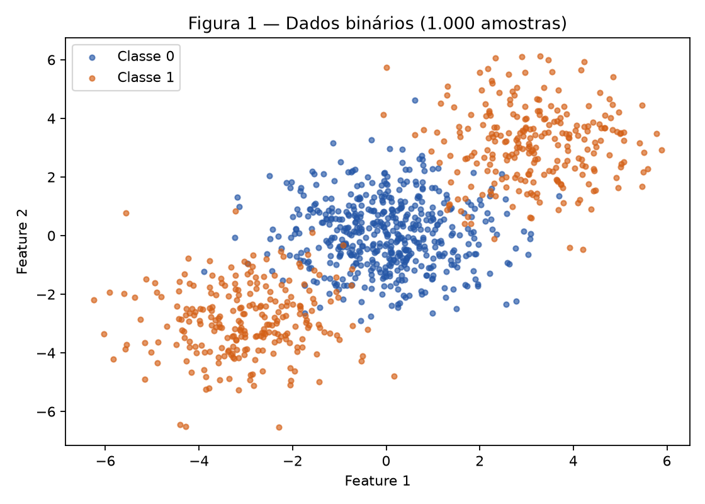
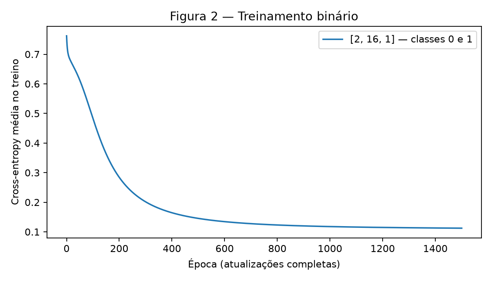
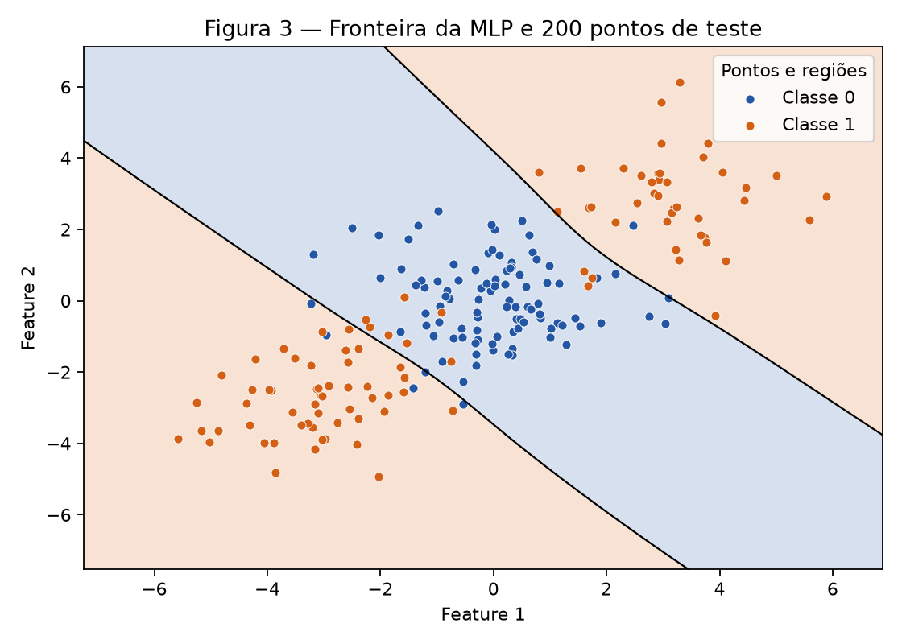
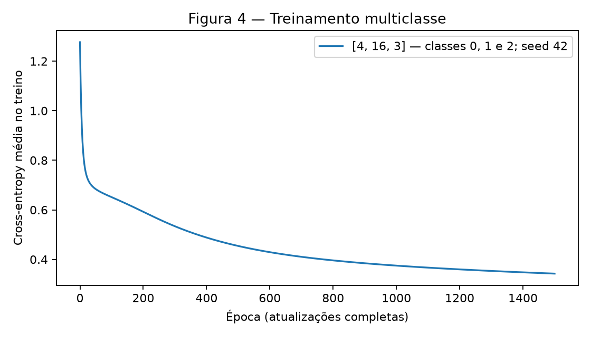
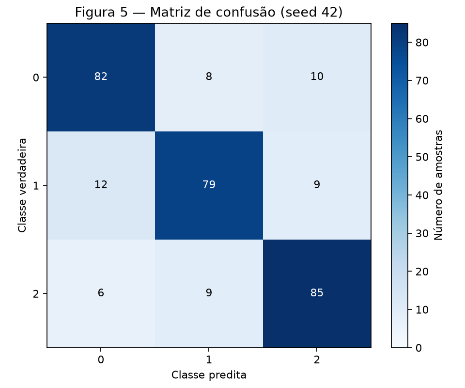
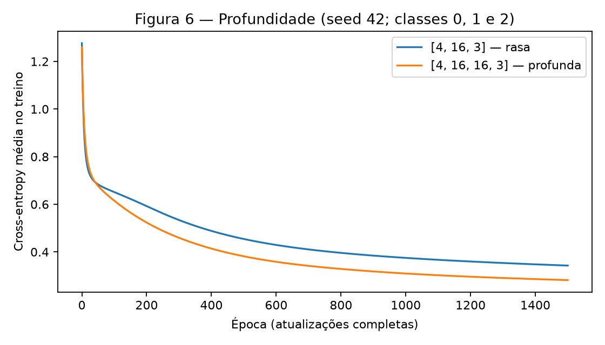

# Atividade 3 — Multi-Layer Perceptron

**Aluno:** Daniel Marco Djanikian. Disciplina: Artificial Neural Networks and
Deep Learning, Insper, 2026.2.

Referências: [enunciado e rubrica oficiais](https://insper.github.io/ann-dl/2026.2/exercises/mlp/)
e [formato de submissão](https://insper.github.io/ann-dl/2026.2/exercises/submission/).
As contas do Exercise 1 são desenvolvidas abaixo; NumPy serve para conferência.
Nos demais exercícios, uma única MLP implementa manualmente as ativações,
losses, forward, backward e atualização dos parâmetros.

Para reproduzir, na raiz de um clone do repositório, com Python 3.12:

```bash
python3.12 -m venv env
source env/bin/activate
python -m pip install -r requirements.txt
python docs/exercises/mlp/code/mlp.py > /tmp/mlp-resultados.json
python docs/exercises/mlp/code/mlp.py > /tmp/mlp-repeticao.json
diff -u /tmp/mlp-resultados.json /tmp/mlp-repeticao.json
mkdocs build --strict
```

O script gera `figures/fig1.png` a `figures/fig6.png` e imprime todas as métricas
e as contas de conferência em JSON; não reescreve o relatório. Não é necessário
baixar dados. As dependências já estão fixadas no `requirements.txt` do
repositório: NumPy 2.5.2, Matplotlib 3.11.1 e scikit-learn 1.9.0.

**Protocolo fixo:** dados originais, sem normalização; tanh nas camadas ocultas;
Xavier uniforme; biases zero; gradient descent full-batch com learning rate
\(0{,}1\) e **1.500 atualizações**, sem regularização ou early stopping.
Nenhum hiperparâmetro foi escolhido por acurácia no teste. A loss da época 0
é medida antes de treinar; a da época 1.500, após a última atualização.

O experimento binário usa `rng = np.random.default_rng(42)`. A exceção são
as repetições pareadas dos Exercises 3 e 4: cada arquitetura começa com um
gerador novo `np.random.default_rng(seed)`, para seeds **42, 43 e 44**. O
resultado raso com seed 42 é o resultado principal do Exercise 3, reutilizado
no Exercise 4. Os dados e o split continuam com `random_state=42` em todas as
repetições; só a inicialização dos pesos varia. A auditoria usa um gerador
separado com seed 2026 e não consome os geradores dos experimentos.

## Exercise 1

### A — Forward pass

Neste exercício, vetores são colunas e os pesos seguem a orientação do
enunciado: \(z^{(1)}=W^{(1)}x+b^{(1)}\). São dados:

\[
x=\begin{bmatrix}0.5\\-0.2\end{bmatrix},\quad y=1.0,\quad
W^{(1)}=\begin{bmatrix}0.3&-0.1\\0.2&0.4\end{bmatrix},\quad
b^{(1)}=\begin{bmatrix}0.1\\-0.2\end{bmatrix},
\]

\[
W^{(2)}=\begin{bmatrix}0.5&-0.3\end{bmatrix},\quad b^{(2)}=0.2.
\]

As duas pré-ativações ocultas são:

\[
z^{(1)}_1=0.3(0.5)+(-0.1)(-0.2)+0.1
=0.150000+0.020000+0.100000=0.270000,
\]

\[
z^{(1)}_2=0.2(0.5)+0.4(-0.2)-0.2
=0.100000-0.080000-0.200000=-0.180000.
\]

Aplicando \(\tanh(z)=(e^z-e^{-z})/(e^z+e^{-z})\):

\[
h^{(1)}_1=\tanh(0.270000)=0.263625,\qquad
h^{(1)}_2=\tanh(-0.180000)=-0.178081.
\]

A pré-ativação e a ativação da saída são:

\[
u^{(2)}=0.5(0.263625)+(-0.3)(-0.178081)+0.2
\approx0.131812+0.053424+0.200000=0.385237,
\]

\[
\hat y=\tanh(0.385237)=0.367247.
\]

Para uma amostra, a MSE do enunciado não tem o fator \(1/2\):

\[
L=(y-\hat y)^2=(1.000000-0.367247)^2=\boxed{0.400377}.
\]

Os números são apresentados com seis casas decimais. Os cálculos seguintes
usam a precisão completa, sem acumular o arredondamento exibido.

### B — Backward pass

Começamos pela loss e aplicamos a regra da cadeia em cada ligação.

**1. Da loss à pré-ativação da saída.**

\[
\frac{\partial L}{\partial\hat y}
=2(\hat y-y)=2(0.367247-1.000000)=-1.265507,
\]

\[
\frac{\partial\hat y}{\partial u^{(2)}}
=1-\tanh^2(u^{(2)})=1-(0.367247)^2=0.865130,
\]

\[
\delta^{(2)}=\frac{\partial L}{\partial u^{(2)}}
=\frac{\partial L}{\partial\hat y}
 \frac{\partial\hat y}{\partial u^{(2)}}
=(-1.265507)(0.865130)=\boxed{-1.094828}.
\]

**2. Pesos e bias da saída.** Como \(u^{(2)}=\sum_j W^{(2)}_j h^{(1)}_j+b^{(2)}\),
temos \(\partial u^{(2)}/\partial W^{(2)}_j=h^{(1)}_j\)
e \(\partial u^{(2)}/\partial b^{(2)}=1\). Logo:

\[
\frac{\partial L}{\partial W^{(2)}_1}
=\delta^{(2)}h^{(1)}_1=(-1.094828)(0.263625)=-0.288624,
\]

\[
\frac{\partial L}{\partial W^{(2)}_2}
=\delta^{(2)}h^{(1)}_2=(-1.094828)(-0.178081)=0.194968,
\]

\[
\frac{\partial L}{\partial b^{(2)}}=\delta^{(2)}(1)=-1.094828.
\]

**3. Da saída às ativações e pré-ativações ocultas.**
Como \(\partial u^{(2)}/\partial h^{(1)}_j=W^{(2)}_j\):

\[
\frac{\partial L}{\partial h^{(1)}_1}
=\delta^{(2)}W^{(2)}_1=(-1.094828)(0.500000)=-0.547414,
\]

\[
\frac{\partial L}{\partial h^{(1)}_2}
=\delta^{(2)}W^{(2)}_2=(-1.094828)(-0.300000)=0.328448.
\]

As derivadas locais de tanh são:

\[
\frac{\partial h^{(1)}_1}{\partial z^{(1)}_1}
=1-(0.263625)^2=0.930502,\quad
\frac{\partial h^{(1)}_2}{\partial z^{(1)}_2}
=1-(-0.178081)^2=0.968287.
\]

Cada ativação depende apenas de sua própria pré-ativação; as derivadas
cruzadas são zero. Multiplicando os fatores de cada caminho:

\[
\delta^{(1)}_1=\frac{\partial L}{\partial z^{(1)}_1}
=(-0.547414)(0.930502)=-0.509370,
\]

\[
\delta^{(1)}_2=\frac{\partial L}{\partial z^{(1)}_2}
=(0.328448)(0.968287)=0.318032.
\]

**4. Pesos e biases ocultos.** Como
\(z^{(1)}_i=\sum_j W^{(1)}_{ij}x_j+b^{(1)}_i\),
\(\partial z^{(1)}_i/\partial W^{(1)}_{ij}=x_j\) e
\(\partial z^{(1)}_i/\partial b^{(1)}_i=1\). Assim:

\[
\frac{\partial L}{\partial W^{(1)}_{11}}
=(-0.509370)(0.500000)=-0.254685,\qquad
\frac{\partial L}{\partial W^{(1)}_{12}}
=(-0.509370)(-0.200000)=0.101874,
\]

\[
\frac{\partial L}{\partial W^{(1)}_{21}}
=(0.318032)(0.500000)=0.159016,\qquad
\frac{\partial L}{\partial W^{(1)}_{22}}
=(0.318032)(-0.200000)=-0.063606,
\]

\[
\frac{\partial L}{\partial b^{(1)}_1}=-0.509370,\qquad
\frac{\partial L}{\partial b^{(1)}_2}=0.318032.
\]

Portanto, na orientação do enunciado:

\[
\nabla_{W^{(1)}}L=
\begin{bmatrix}-0.254685&0.101874\\0.159016&-0.063606\end{bmatrix},\quad
\nabla_{b^{(1)}}L=\begin{bmatrix}-0.509370\\0.318032\end{bmatrix},
\]

\[
\nabla_{W^{(2)}}L=\begin{bmatrix}-0.288624&0.194968\end{bmatrix},\quad
\nabla_{b^{(2)}}L=-1.094828.
\]

### C — Parameter update

Aplicamos simultaneamente \(\theta_{novo}=\theta-0.3\,\partial L/\partial\theta\),
usando todos os gradientes calculados com os parâmetros antigos.
O texto menciona oito parâmetros, mas são **nove escalares**:
quatro pesos ocultos, dois biases ocultos, dois pesos de saída e um bias de saída.

| Parâmetro | Substituição na atualização | Novo valor |
| --- | --- | ---: |
| \(W^{(1)}_{11}\) | \(0.300000-0.3(-0.254685)\) | 0.376405 |
| \(W^{(1)}_{12}\) | \(-0.100000-0.3(0.101874)\) | -0.130562 |
| \(W^{(1)}_{21}\) | \(0.200000-0.3(0.159016)\) | 0.152295 |
| \(W^{(1)}_{22}\) | \(0.400000-0.3(-0.063606)\) | 0.419082 |
| \(b^{(1)}_1\) | \(0.100000-0.3(-0.509370)\) | 0.252811 |
| \(b^{(1)}_2\) | \(-0.200000-0.3(0.318032)\) | -0.295410 |
| \(W^{(2)}_1\) | \(0.500000-0.3(-0.288624)\) | 0.586587 |
| \(W^{(2)}_2\) | \(-0.300000-0.3(0.194968)\) | -0.358490 |
| \(b^{(2)}\) | \(0.200000-0.3(-1.094828)\) | 0.528448 |

Conferindo com um segundo forward pass:

\[
z^{(1)}_{novo,1}=0.376405(0.5)+(-0.130562)(-0.2)+0.252811
\approx0.467126,
\]

\[
z^{(1)}_{novo,2}=0.152295(0.5)+0.419082(-0.2)-0.295410
\approx-0.303079,
\]

\[
h^{(1)}_{novo}=\begin{bmatrix}\tanh(0.467126)\\\tanh(-0.303079)\end{bmatrix}
=\begin{bmatrix}0.435874\\-0.294127\end{bmatrix},
\]

\[
u^{(2)}_{novo}=0.586587(0.435874)+(-0.358490)(-0.294127)+0.528448
\approx0.889568,
\]

\[
\hat y_{novo}=\tanh(0.889568)=0.711181,\qquad
L_{novo}=(1-0.711181)^2=\boxed{0.083417}.
\]

A loss **diminui de 0.400377 para 0.083417**: o passo na direção oposta ao
gradiente aproxima a previsão do alvo 1. Uma taxa arbitrariamente grande
não garantiria essa diminuição; aqui ela foi confirmada numericamente.

## Exercise 2

### A — Generate the data

Foi executado `make_blobs(n_samples=[500, 250, 250],
centers=np.array([[0., 0.], [3., 3.], [-3., -3.]]),
cluster_std=1.2, random_state=42)`, seguido de `y = (clusters > 0).astype(int)`.
São **1.000 pontos**, com 500 na classe 0 e 500 na classe 1. O split
`train_test_split(..., test_size=0.2, random_state=42, stratify=y)` fornece
**800 pontos de treino (400 por classe)** e **200 de teste (100 por classe)**.



*Figura 1 — O cluster da classe 0 fica entre os dois clusters da classe 1.
Os eixos são as duas features originais e a legenda identifica as classes.*

### B — Establish the baseline

`LogisticRegression(max_iter=1000)`, com os demais argumentos padrão,
foi ajustada somente no treino. A acurácia de teste foi **47,50% (95/200)**.
O solver padrão é determinístico neste problema. Esta é a única utilização
de um classificador pronto, junto ao baseline explicitamente pedido no
Exercise 3. A acurácia da MLP é calculada diretamente com NumPy.

### C — Implement the MLP

A arquitetura **[2, 16, 1]** tem uma camada oculta tanh e uma saída sigmoid,
com **65 parâmetros**: \(2(16)+16+16(1)+1\). Foram usadas **1.500 épocas**,
learning rate **0,1**, batch com os **800 exemplos de treino** e seed **42**.
A loss caiu de **0.762159** para **0.112369** e a acurácia de teste foi
**92,00% (184/200)**.

No código, cada amostra ocupa uma linha: \(A^{(0)}=X\),
\(W^{(l)}\in\mathbb R^{d_{l-1}\times d_l}\),
\(b^{(l)}\in\mathbb R^{d_l}\). Essa orientação é a transposta da usada
na conta individual do Exercise 1. O forward é:

\[
Z^{(l)}=A^{(l-1)}W^{(l)}+b^{(l)},\qquad
A^{(l)}=\tanh(Z^{(l)})\quad(l<L),\qquad
p=\sigma(Z^{(L)}).
\]

A inicialização é
\(W^{(l)}_{ij}\sim U[-\sqrt{6/(d_{l-1}+d_l)},\sqrt{6/(d_{l-1}+d_l)}]\).
Ela evita pesos iniciais excessivos para tanh; biases começam em zero.

Para \(N\) amostras, a binary cross-entropy e suas derivadas são:

\[
L=-\frac1N\sum_i[y_i\log p_i+(1-y_i)\log(1-p_i)],
\]

\[
\frac{\partial L}{\partial p_i}
=\frac1N\left(-\frac{y_i}{p_i}+\frac{1-y_i}{1-p_i}\right)
=\frac{p_i-y_i}{Np_i(1-p_i)},\quad
\frac{\partial p_i}{\partial z_i}=p_i(1-p_i),
\]

\[
\Delta^{(L)}_i=\frac{\partial L}{\partial z_i}=\frac{p_i-y_i}{N}.
\]

A implementação avalia a mesma loss pelos logits,
\(L=\operatorname{mean}(\operatorname{logaddexp}(0,z)-yz)\),
e calcula a sigmoid como \(e^{-\operatorname{logaddexp}(0,-z)}\).
Assim não é necessário tomar \(\log(0)\), nem recortar probabilidades.

Nas camadas anteriores, aplicamos a regra da cadeia:

\[
\frac{\partial L}{\partial W^{(l)}}=(A^{(l-1)})^T\Delta^{(l)},\qquad
\frac{\partial L}{\partial b^{(l)}}=\sum_{i=1}^N\Delta^{(l)}_i,
\]

\[
\Delta^{(l-1)}=
\left(\Delta^{(l)}(W^{(l)})^T\right)
\odot\left(1-(A^{(l-1)})^2\right),\quad l>1.
\]

A divisão por \(N\) ocorre apenas na saída, para não ser aplicada várias
vezes. Todos os gradientes são calculados antes de atualizar os parâmetros:
\(W^{(l)}\leftarrow W^{(l)}-\eta\nabla_{W^{(l)}}L\) e
\(b^{(l)}\leftarrow b^{(l)}-\eta\nabla_{b^{(l)}}L\).
A previsão é classe 1 se \(p\geq0.5\), classe 0 caso contrário.

O arquivo abaixo é o código completo efetivamente executado. `forward`,
`backward`, `update` e `train` são reutilizados sem modificação nos
Exercises 3 e 4; o argumento `task` controla a saída e a loss.

```python
--8<-- "docs/exercises/mlp/code/mlp.py"
```



*Figura 2 — Loss média no treino, da inicialização até a atualização 1.500.*



*Figura 3 — Regiões avaliadas em uma grade 300 × 300. Azul indica classe 0;
laranja, classe 1. A linha preta corresponde a \(p=0.5\); os pontos são
exclusivamente do teste. A grade é usada para visualizar o modelo treinado.*

### D — Analysis

A Figura 3 mostra uma faixa diagonal azul envolvendo o cluster central,
com duas regiões laranja em lados opostos, nas direções de \((3,3)\) e
\((-3,-3)\). As duas bordas da faixa são levemente curvas. Uma única
fronteira linear divide o plano em dois semiplanos e não pode atribuir ambos
os extremos à classe 1 mantendo o centro na classe 0. A combinação das
16 ativações tanh permite construir essas duas transições.

O baseline obteve **47,50%**, enquanto a MLP obteve **92,00%**, diferença de
**44,50 pontos percentuais**. Pela simetria aproximada dos dois clusters
externos, a classe 1 não apresenta um deslocamento de média que uma regressão
logística consiga explorar bem. Pequenas assimetrias da amostra levam a uma
reta com desempenho de teste ligeiramente abaixo de 50%; isso não é uma
propriedade universal da regressão logística. Uma previsão constante obteria
50% neste teste balanceado. A sobreposição das nuvens explica parte dos erros
que permanecem mesmo com a fronteira não linear.

## Exercise 3

### A — Generate the data

Foi executado exatamente:
`make_classification(n_samples=1500, n_features=4, n_informative=4,
n_redundant=0, n_repeated=0, n_classes=3, n_clusters_per_class=2,
class_sep=1.0, random_state=42)`.
O split estratificado 80/20 com seed 42 produziu **1.200 amostras de treino**
e **300 de teste**, com shapes `(1200, 4)` e `(300, 4)`.

| Classe | Total | Treino | Teste |
| ---: | ---: | ---: | ---: |
| 0 | 499 | 399 | 100 |
| 1 | 499 | 399 | 100 |
| 2 | 502 | 402 | 100 |

Há quatro features informativas e seis clusters, dois por classe. Os defaults
restantes do gerador foram preservados, inclusive `flip_y=0.01`: a pequena
variação nas contagens é compatível com os rótulos perturbados pelo gerador.
Não foi feito pré-processamento nem ajuste com os dados de teste.

### B — Adapt the network

A arquitetura passa a ser **[4, 16, 3]**. Mudam as dimensões, o argumento
`task="multiclass"`, a saída softmax e a categorical cross-entropy.
O mesmo laço de camadas implementa o forward, o backward e a atualização.

Para uma amostra, sejam \(u\) os três logits, \(p\) as probabilidades e
\(Y\) o alvo one-hot, com \(\sum_kY_k=1\):

\[
p_k=\frac{e^{u_k}}{\sum_re^{u_r}},\qquad
\ell=-\sum_kY_k\log p_k.
\]

Derivando o quociente, com \(S=\sum_r e^{u_r}\):

\[
\frac{\partial p_k}{\partial u_j}
=\frac{\mathbf1_{k=j}e^{u_k}S-e^{u_k}e^{u_j}}{S^2}
=p_k(\mathbf1_{k=j}-p_j).
\]

Além disso, \(\partial\ell/\partial p_k=-Y_k/p_k\).
A regra da cadeia soma a contribuição de todas as probabilidades:

\[
\frac{\partial\ell}{\partial u_j}
=\sum_k\frac{\partial\ell}{\partial p_k}
        \frac{\partial p_k}{\partial u_j}
=\sum_k\left(-\frac{Y_k}{p_k}\right)p_k(\mathbf1_{k=j}-p_j)
=-Y_j+p_j\sum_kY_k=\boxed{p_j-Y_j}.
\]

Para a loss média \(L=N^{-1}\sum_i\ell_i\):

\[
\Delta^{(L)}=\frac{\partial L}{\partial U}=\boxed{\frac{P-Y}{N}}.
\]

Essa é a mesma expressão usada com sigmoid + BCE, com alvos agora one-hot.
Os gradientes das camadas ocultas seguem as equações do Exercise 2.
Na implementação, subtraímos \(m_i=\max_k u_{ik}\) antes de exponenciar.
Isso preserva a softmax e permite calcular a loss de forma estável:

\[
\ell_i=\log\sum_k e^{u_{ik}-m_i}-(u_{i,y_i}-m_i).
\]

### C — Train and evaluate

A rede **[4, 16, 3]** tem **131 parâmetros**:
\((4\cdot16+16)+(16\cdot3+3)=80+51\).
Com seed **42**, tanh, softmax, categorical cross-entropy, Xavier uniforme,
batch **1.200**, learning rate **0,1** e **1.500 épocas**, a loss caiu de
**1.276697** para **0.342706**. A previsão é `argmax` da saída.
A acurácia de teste foi **82,00% (246/300)**.



*Figura 4 — Rede rasa multiclasse com seed 42; o conjunto de teste não
participa da atualização dos parâmetros.*



*Figura 5 — Linhas: classes verdadeiras; colunas: classes preditas.
Os rótulos 0, 1 e 2 identificam as classes nos dois eixos; a escala de cor
indica contagens. São 100 exemplos de teste por classe.*

Os números da matriz também são apresentados no texto:

| Verdadeira / Predita | 0 | 1 | 2 |
| --- | ---: | ---: | ---: |
| 0 | 82 | 8 | 10 |
| 1 | 12 | 79 | 9 |
| 2 | 6 | 9 | 85 |

### D — Analysis

O par mais confundido é **classes 0 e 1**, somando as duas direções:
\(C_{01}+C_{10}=8+12=\mathbf{20}\) erros. Os outros pares têm
\(C_{02}+C_{20}=10+6=16\) e \(C_{12}+C_{21}=9+9=18\) erros.
O maior erro dirigido é 1 → 0, com 12 amostras.

Cada classe ocupa dois clusters em um espaço de quatro dimensões. Portanto,
uma classe não precisa ocupar uma região convexa única e pode se aproximar
de clusters de outras classes. Essa estrutura permite fronteiras complexas e
é compatível com a confusão observada. A matriz não revela as coordenadas ou
os clusters de origem dos erros; a atribuição de uma sobreposição específica
ao par 0–1 é uma hipótese geométrica, não algo demonstrado pela matriz.
As quatro features serem informativas não garante separação perfeita,
especialmente com sobreposição e a perturbação de rótulos do gerador.

O baseline `LogisticRegression(max_iter=1000)` foi ajustado no mesmo treino
e obteve **66,33% (199/300)**. A camada oculta acrescentou **15,67 pontos
percentuais** ao permitir transformar as quatro entradas antes da separação
das três classes. O resultado de 82,00% ficou pouco abaixo da referência
aproximada de 83–86% do enunciado. A loss decresce e os gradientes foram
verificados; esse intervalo foi usado como diagnóstico, sem ajustar o método
para forçar uma acurácia. Nas três inicializações, a média rasa foi 83,11%.

## Exercise 4

### A — Train the deeper network

A rede profunda é **[4, 16, 16, 3]**, com duas camadas ocultas tanh e
**403 parâmetros**:

\[
(4\cdot16+16)+(16\cdot16+16)+(16\cdot3+3)
=80+272+51=403.
\]

São os mesmos dados e split do Exercise 3, sem gerar nova amostra.
Foram mantidos Xavier uniforme, biases zero, loss, full-batch, learning rate
**0,1** e **1.500 épocas**. Com seed **42**, a acurácia foi **86,67% (260/300)**
e a loss final de treino foi **0.281627**. A largura 16 das camadas ocultas
foi preservada; a alteração arquitetural foi acrescentar uma camada de 16.

### B — Compare

As duas arquiteturas foram treinadas com seeds **42, 43 e 44**, reiniciando
um gerador NumPy com a mesma seed em cada par. O primeiro bloco de pesos
tem inclusive os mesmos valores iniciais em cada par, pois seu shape é
`(4, 16)` nos dois modelos. Os demais blocos têm shapes diferentes.
Cada execução realiza o mesmo número de atualizações com todos os 1.200
exemplos de treino. A rede profunda exige mais operações por atualização,
então este é um controle por épocas, sem equiparar tempo de processamento.



*Figura 6 — Os dois modelos usam seed 42 e os mesmos hiperparâmetros.
Ambas as curvas incluem a época 0 e a loss após 1.500 atualizações.*

Resultados de **cada execução**, medidos após a última atualização:

| Seed | Arquitetura | Camadas ocultas | Parâmetros | Loss final de treino | Acurácia de teste |
| ---: | --- | ---: | ---: | ---: | ---: |
| 42 | [4, 16, 3] | 1 | 131 | 0.342706 | 82,00% (246/300) |
| 42 | [4, 16, 16, 3] | 2 | 403 | 0.281627 | 86,67% (260/300) |
| 43 | [4, 16, 3] | 1 | 131 | 0.354570 | 83,33% (250/300) |
| 43 | [4, 16, 16, 3] | 2 | 403 | 0.279323 | 85,33% (256/300) |
| 44 | [4, 16, 3] | 1 | 131 | 0.348660 | 84,00% (252/300) |
| 44 | [4, 16, 16, 3] | 2 | 403 | 0.267090 | 86,33% (259/300) |

A tabela de comparação obrigatória abaixo utiliza **médias das três seeds**
para loss e acurácia:

| Modelo | Camadas ocultas | Parâmetros | Loss final de treino (média) | Acurácia de teste (média) |
| --- | ---: | ---: | ---: | ---: |
| Exercise 3 — [4, 16, 3] | 1 | 131 | 0.348645 | 83,11% |
| Exercise 4 — [4, 16, 16, 3] | 2 | 403 | 0.276014 | 86,11% |

As diferenças pareadas de acurácia (profunda − rasa), em pontos percentuais,
são **+4,67** (42), **+2,00** (43) e **+2,33** (44). Usando os valores sem
arredondamento:

\[
\overline{a}_{profunda}-\overline{a}_{rasa}
=86.111111\%-83.111111\%=\boxed{+3.00\text{ pontos percentuais}}.
\]

### C — Analysis

A segunda camada **ajudou neste experimento**: a acurácia média passou de
**83,11% para 86,11%** e a loss média de treino caiu de **0.348645 para
0.276014**. A rede profunda venceu nos três pares. Na seed 42, a Figura 6
mostra loss final menor (**0.281627 contra 0.342706**), acompanhada de maior
acurácia (**86,67% contra 82,00%**). Portanto, neste conjunto, os resultados de
treino e teste apontam na mesma direção. Não houve busca de hiperparâmetros
nem ajuste para produzir esse resultado.

A composição de duas transformações tanh permite combinar características
intermediárias e pode ajudar a organizar as regiões dos seis clusters. Isso
também elevou o número de parâmetros de **131 para 403**, acréscimo de **272**
e aproximadamente **3,08 vezes** o total original. Assim, o ganho observado
inclui a capacidade adicional trazida pela profundidade: esta comparação
não isola profundidade de quantidade de parâmetros.

Mais camadas introduzem mais produtos de derivadas, podendo dificultar a
otimização, atenuar os gradientes e aumentar a sensibilidade à inicialização.
Aqui isso não impediu a rede profunda de obter menor loss no orçamento fixo.
Seis clusters não exigem necessariamente grande profundidade: uma rede rasa
com largura suficiente também pode modelar regiões complexas. Em problemas
com estrutura hierárquica, como partes locais que compõem objetos em imagens,
compor representações em várias camadas pode ser mais útil.

As três seeds fornecem uma comparação descritiva das inicializações neste
único split, sem demonstrar superioridade universal ou significância
estatística em outros conjuntos de dados.

#### Verificação técnica e leitura do código

O script foi executado duas vezes no ambiente informado, com resultados
JSON idênticos. A auditoria numérica calcula, para cada peso e cada bias:

\[
g_{num}(\theta)=\frac{L(\theta+10^{-5})-L(\theta-10^{-5})}{2\cdot10^{-5}}.
\]

Os maiores erros absolutos entre esse valor e o backward analítico foram:

| Arquitetura | Parâmetros verificados | Maior erro absoluto |
| --- | ---: | ---: |
| [2, 16, 1] | 65 | \(1.25\times10^{-11}\) |
| [4, 16, 3] | 131 | \(3.67\times10^{-11}\) |
| [4, 16, 16, 3] | 403 | \(9.17\times10^{-11}\) |

Todos passaram a tolerância de \(10^{-7}\). As dimensões das ativações e
gradientes também são verificadas. Com logits de magnitude 1.000, sigmoid,
softmax e as losses permaneceram finitas, inclusive para previsões erradas
com alta confiança (BCE 1.000 e categorical cross-entropy 2.000).
Nenhum treinamento produziu NaN ou infinito. As probabilidades de teste
estão entre 0 e 1 e as saídas softmax somam 1 por amostra.

As seis figuras foram geradas, numeradas e incorporadas. O site passou em
`mkdocs build --strict`; o snippet incorpora o arquivo executável. Os
experimentos utilizam apenas os geradores e splits indicados; o sklearn
participa também da matriz de confusão e dos dois baselines autorizados.
Nenhum dado ou componente do projeto EDA é utilizado.

Para explicar o backpropagation: `forward` guarda o que cada camada recebeu
e produziu; `backward` começa com o erro de saída \((P-Y)/N\), calcula quanto
cada peso contribuiu para esse erro e o propaga para a camada anterior pela
regra da cadeia. A derivada de tanh é obtida da ativação já guardada,
\(1-A^2\). `update` subtrai de cada parâmetro o gradiente multiplicado por
0,1. A repetição desse processo reduz a loss de treino. Acrescentar uma
camada muda a lista de matrizes percorridas, sem exigir outro algoritmo.

## Results summary

| # | Quantity | Value |
| ---: | --- | --- |
| 1 | Ex. 1 — \(z^{(1)}\) e \(h^{(1)}\) | \(z^{(1)}=[0.270000,-0.180000]\); \(h^{(1)}=[0.263625,-0.178081]\) |
| 2 | Ex. 1 — \(u^{(2)}\), \(\hat y\) e \(L\) | \(u^{(2)}=0.385237\); \(\hat y=0.367247\); \(L=0.400377\) |
| 3 | Ex. 1 — Todos os nove parâmetros atualizados | \(W^{(1)}=\begin{bmatrix}0.376405&-0.130562\\0.152295&0.419082\end{bmatrix}\); \(b^{(1)}=[0.252811,-0.295410]\); \(W^{(2)}=[0.586587,-0.358490]\); \(b^{(2)}=0.528448\) |
| 4 | Ex. 2 — Acurácia de teste do baseline linear | 47,50% |
| 5 | Ex. 2 — Arquitetura e acurácia de teste | [2, 16, 1]; 92,00% (seed 42) |
| 6 | Ex. 3 — Arquitetura e acurácia de teste | [4, 16, 3]; 82,00% (seed 42); média das três seeds: 83,11% |
| 7 | Ex. 3 — Par de classes mais confundido | 0 e 1; 20 erros somando as duas direções |
| 8 | Ex. 4 — Arquitetura e acurácia de teste | [4, 16, 16, 3]; 86,67% (seed 42); média das três seeds: 86,11% |
| 9 | Ex. 4 — Diferença média de acurácia contra Ex. 3 (três seeds) | +3,00 pontos percentuais (profunda − rasa; seeds 42, 43 e 44) |
