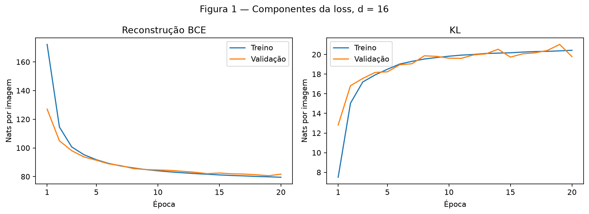
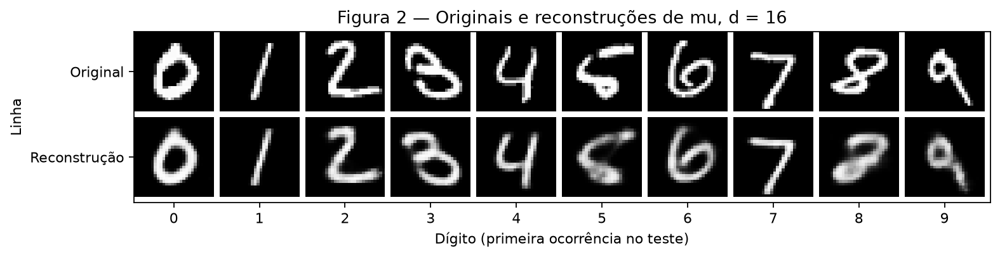
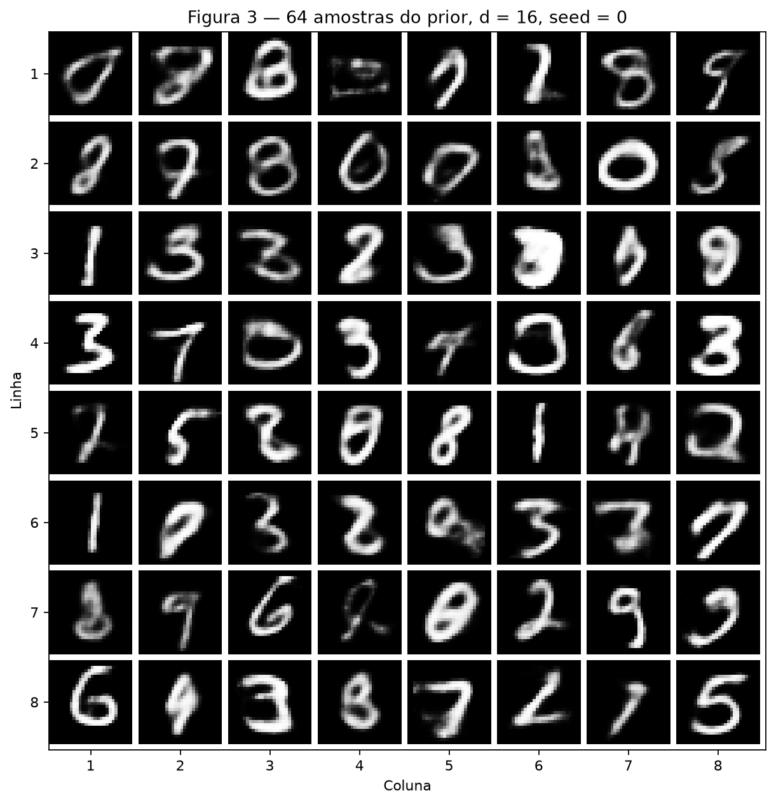
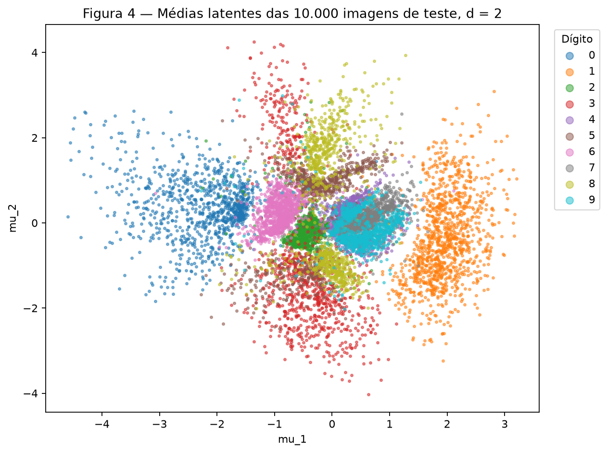
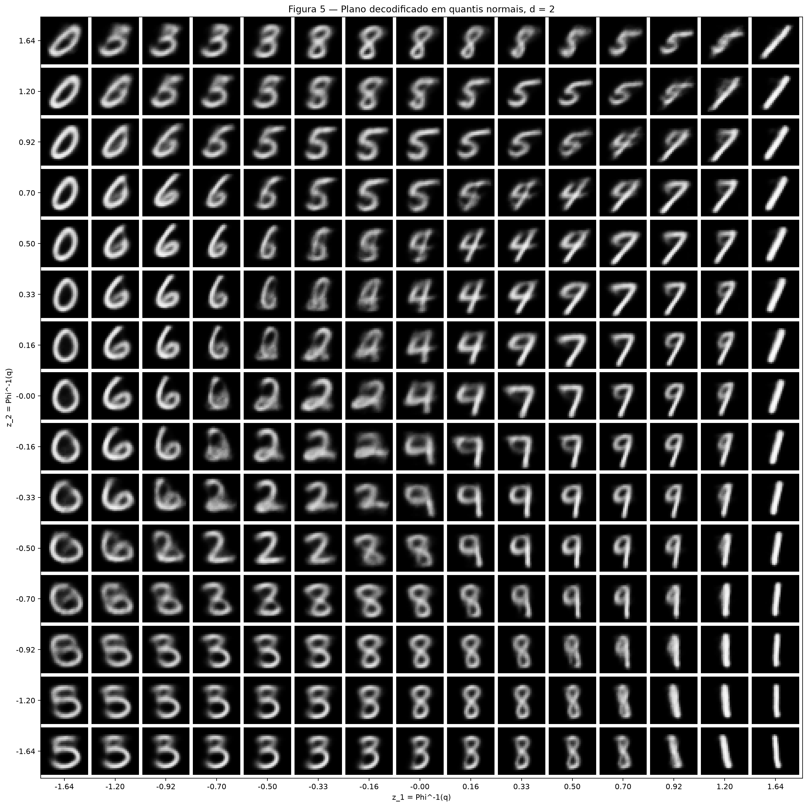
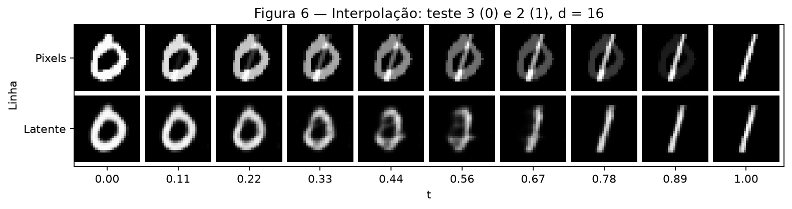

# Atividade 4 — Variational Autoencoders

Foram executados exatamente dois modelos totalmente conectados, com o protocolo
fixo da atividade. Os rótulos dos dígitos não entram no treinamento.

## Exercise 1

### A — Load and split the data

MNIST foi baixado com `torchvision.datasets.MNIST`. `transforms.ToTensor()`
converte cada imagem de 28 × 28 pixels para `float32` em [0, 1]; o encoder
achata a imagem em 784 valores. Não há outras transformações.

As 60.000 imagens oficiais de treinamento foram separadas em **50.000 de
treino e 10.000 de validação** com `random_split` e
`torch.Generator().manual_seed(42)`. As **10.000 imagens oficiais de teste**
foram carregadas e avaliadas somente após concluir os dois treinamentos.
O código verifica que os índices são reproduzíveis, disjuntos e cobrem as
60.000 imagens, além das dimensões, tipo e intervalo dos pixels.

### B — Build the model

Uma única classe `VAE(nn.Module)` implementa ambos os exercícios:

| Parte | Camadas |
| --- | --- |
| Encoder | Linear 784 → 512, ReLU, Linear 512 → 256, ReLU |
| Heads | Duas Linear 256 → d, independentes: `mu` e `logvar` |
| Decoder | Linear d → 256, ReLU, Linear 256 → 512, ReLU, Linear 512 → 784, Sigmoid |

Aqui **d = 16**, com **1.079.600 parâmetros treináveis**.
`mu` é o centro da distribuição latente da imagem; `logvar` é o logaritmo
da variância em cada dimensão. A covariância é diagonal:

\[
q_\phi(z\mid x)=\mathcal N(\mu,\operatorname{diag}(\exp(\mathrm{logvar}))).
\]

O logaritmo permite que a rede produza qualquer número real, mantendo a
variância positiva após a exponencial. A amostragem é escrita explicitamente:

\[
\epsilon\sim\mathcal N(0,I),\quad
\sigma=\exp(0.5\,\mathrm{logvar}),\quad z=\mu+\sigma\odot\epsilon.
\]

O ruído não depende dos pesos. Fixado esse ruído durante cada forward, `z`
é uma função diferenciável de `mu` e `logvar`, permitindo que o gradiente
da reconstrução chegue ao encoder. O decoder retorna 784 probabilidades
entre 0 e 1, usadas diretamente nas imagens exibidas.

Para um batch de B imagens, com **β = 1**, a loss é:

\[
R=-\frac1B\sum_{b=1}^B\sum_{j=1}^{784}
\left[x_{bj}\log\hat x_{bj}+(1-x_{bj})\log(1-\hat x_{bj})\right],
\]

\[
K=\frac1{2B}\sum_{b=1}^B\sum_{i=1}^{d}
\left[\mu_{bi}^2+\exp(\mathrm{logvar}_{bi})-1-\mathrm{logvar}_{bi}\right],
\qquad L=R+K.
\]

A BCE penaliza reconstruções incompatíveis com os pixels, sob uma likelihood
Bernoulli. A KL penaliza o afastamento de `q(z|x)` do prior normal padrão.
Ambas são somadas nas dimensões e divididas **apenas pelo número de imagens**;
portanto, todas as perdas são dadas em **nats por imagem**. A KL é implementada
pela fórmula acima, sem funções de distribuições. A BCE usa
`F.binary_cross_entropy(..., reduction="sum") / B`, conforme o enunciado.

**Código completo executado**, incluindo verificações, treinamento e figuras:

```python
--8<-- "docs/exercises/vae/code/vae.py"
```

### C — Train

Adam, **learning rate 0,001**, **batch size 128**, **20 épocas**,
seed **42 antes de construir cada modelo**. A execução ocorreu em **CPU com
uma thread**, sem early stopping ou seleção de hiperparâmetros. O teste não
orientou nenhuma decisão. A validação não calcula gradientes nem atualiza pesos.

As médias de treino ponderam cada batch por seu número de imagens, inclusive
o último batch incompleto. Elas são medidas ao longo da época, enquanto os
pesos mudam. A validação usa os pesos do fim da época. BCE e KL são registradas
separadamente em ambos os conjuntos em todas as épocas.

| Conjunto / medição | Reconstrução | KL | Total (ELBO negativa) |
| --- | ---: | ---: | ---: |
| Treino, média da época 20 | 79,529 | 20,426 | 99,955 |
| Validação, fim da época 20 | 81,702 | 19,781 | 101,482 |
| Teste, após o treinamento | 81,025 | 19,862 | 100,887 |

Os valores foram arredondados individualmente a três casas; a soma dos termos
exibidos pode diferir do total exibido em 0,001.

Na avaliação numérica, usa-se **uma amostra de `q(z|x)` por imagem**, com
seed 42 para a passagem de teste: a BCE é uma estimativa Monte Carlo do termo
esperado da ELBO. A KL é analítica. Esses números diferem da reconstrução
visual determinística com `decode(mu)`.



**Figura 1.** Os dois componentes são mostrados na mesma unidade, em painéis
distintos. A perda total de validação caiu de **139,915** para
**101,482**, enquanto a KL mudou de **12,815** para
**19,781** nats por imagem.

### D — Reconstructions and samples



**Figura 2.** Linha superior: primeiras ocorrências dos dígitos 0–9 no teste,
respectivamente nos índices **3, 2, 1, 18, 4, 8, 11, 0, 61, 7** (indexação começa em zero).
Linha inferior: `decode(mu)` das mesmas imagens, na mesma ordem.
Os contornos de 0, 1, 2, 4, 6 e 7 permanecem reconhecíveis;
5 e 8 perdem detalhes dos traços e laços, e o 9 fica mais difuso.
As bordas são mais suaves que nos originais.



**Figura 3.** São **64 novas amostras**, geradas após `torch.manual_seed(0)`
com `z = torch.randn(64, 16)` e passadas diretamente ao decoder.
Nenhuma imagem de entrada foi codificada para produzir essa grade.
A grade contém formas reconhecíveis de várias classes, mas também imagens
ambíguas. Por exemplo, a célula da linha 1, coluna 4 tem traços fracos que
não formam claramente um dígito; a da linha 2, coluna 7 lembra um 0.
Há diversidade de formas, sem garantia de nitidez ou reconhecimento em toda célula.

### E — Analysis

**1. Por que pagar mais KL enquanto a loss total cai?** Na validação, a BCE
caiu de **127,100** para **81,702**,
uma redução de **45,399** nats, enquanto a KL aumentou
**6,966** nats. Codificar informação útil sobre cada imagem
exige distinguir sua distribuição latente do prior comum. O otimizador aceita
esse custo porque o ganho na reconstrução é maior: a soma cai
**38,433** nats. Não há necessidade de que ambos os termos
diminuam a cada época.

**2. Duas razões diferentes para a Figura 3 ter imagens piores.** Primeiro,
regularizar cada `q(z|x)` não torna sua distribuição agregada exatamente igual
ao prior: uma amostra de `N(0,I)` pode cair em regiões menos visitadas durante
o treinamento. Já a Figura 2 usa centros codificados de imagens reais.
Segundo, mesmo em uma região conhecida, o decoder Bernoulli retorna
probabilidades por pixel. Quando um código é compatível com traços diferentes,
a BCE favorece probabilidades intermediárias; exibi-las como intensidades
suaviza os traços. Esse é o mecanismo de média condicional associado ao blur,
discutido na [aula de VAE](https://insper.github.io/ann-dl/2026.2/classes/variational-autoencoders/#why-the-samples-are-blurry-and-why-it-does-not-matter),
aqui aplicado à BCE. São duas causas: localização do código e incerteza da
saída para um código fixo. A grade evidencia a diferença visual; não mede
isoladamente a contribuição de cada causa.

**3. Por que `mu` na Figura 2?** Ela elimina a variação introduzida por
`epsilon`, tornando a comparação com cada original determinística. Não é
igual à esperança do decoder sobre todos os `z`, pois o decoder é não linear,
nem substitui a amostragem usada no treinamento e na avaliação da ELBO.

## Exercise 2

### A — Train a 2-D VAE

Foi alterado **somente d, de 16 para 2**: mesmos dados, seed 42,
arquitetura oculta, β = 1, Adam, learning rate 0,001, batch 128 e
20 épocas. Há **1.068.820 parâmetros treináveis**.

| Modelo | Reconstrução de teste | KL de teste | Total de teste |
| --- | ---: | ---: | ---: |
| d = 16 | 81,025 | 19,862 | 100,887 |
| d = 2 | 135,649 | 6,877 | 142,526 |

Em d = 2, as médias da última época de treino foram **134,192**
de BCE, **6,655** de KL e **140,847** de total. Na validação,
foram **136,205**, **6,890** e **143,095**,
respectivamente. O total de validação caiu de **164,268** na época 1
para **143,095** na época 20.

A menor loss de validação de d = 2 ocorreu na época 18 (**142,316**);
a época 20 ficou um pouco acima. Foi mantido o orçamento fixo de 20 épocas,
sem escolher uma época usando o teste.

### B — The encoded test set



**Figura 4.** Cada ponto é `mu` de uma das **10.000 imagens de teste**,
com as duas coordenadas originais, sem redução dimensional. Rótulos servem
exclusivamente para a cor e a legenda, depois de treinar.
Os zeros se concentram à esquerda e os uns à direita, enquanto várias
classes se misturam na região central. Em particular, 4 e 9 se sobrepõem
em torno de `mu_1` entre 0,2 e 0,9 e `mu_2` entre −0,4 e 0,5.
São regiões visuais aproximadas, não fronteiras de classificação.

### C — The decoded plane



**Figura 5.** Foram decodificados **225 pontos**, com cada coordenada igual
a `scipy.stats.norm.ppf(q)` e **15 valores de q igualmente espaçados de 0,05
a 0,95**. Os limites são aproximadamente **−1,645 e 1,645**. O eixo vertical
cresce de baixo para cima, como na Figura 4.

O espaçamento em quantis dá a cada intervalo entre coordenadas vizinhas a
mesma probabilidade normal e, pela independência dos eixos, a cada célula
entre quatro pontos a mesma massa do prior. A massa de cada intervalo é
0,9/14 ≈ 0,064286, mesmo que os espaçamentos em z sejam diferentes.
Na faixa central direita aparecem famílias de 4, 7 e 9; à esquerda,
0 e 6; e na parte inferior, formas de 3 e 8. Várias células repetem
formas semelhantes e nas fronteiras há traços ambíguos.

### D — Interpolation

As imagens escolhidas são as primeiras ocorrências de **0 (índice 3)**
e **1 (índice 2)** no teste, com índices a partir de zero. A regra
de escolha é fixa e não depende da qualidade dos resultados. Para dez
valores igualmente espaçados de t em [0, 1]:

\[
x_t=(1-t)x_a+tx_b,\qquad
\hat x_t=D_{16}\big((1-t)\mu_a+t\mu_b\big).
\]



**Figura 6.** A primeira linha mistura pixels originais; a segunda decodifica
a mistura das médias latentes do **modelo d = 16 do Exercise 1**.
Nos extremos da segunda linha estão reconstruções, não os originais.
Na linha superior, o laço do 0 perde intensidade enquanto aparece o traço
do 1, com os dois desenhos sobrepostos. Na inferior, o laço se estreita
e cede lugar a um traço vertical; as imagens em t ≈ 0,44 e 0,56 são
ambíguas, apesar da transição mais organizada que a mistura de pixels.

### E — Analysis

**1. Sobreposição e transição entre dígitos.** Os dígitos **4 e 9** compartilham a região aproximada
**`mu_1` ∈ [0,2; 0,9], `mu_2` ∈ [−0,4; 0,5]** da Figura 4. Na Figura 5,
fixando **`z_1` ≈ 0,33** e descendo **`z_2` de 0,50 para −0,33**,
aparecem formas de 4 que passam para 9: o traço aberto adquire um laço
mais fechado e uma haste. Os intermediários não têm sempre uma identidade
clara. A comparação é visual; rótulos não definem regiões rígidas do prior.

**2. Custo de representar cada imagem por dois números.** A BCE de teste
aumentou de **81,025** para **135,649**
nats por imagem (**+54,624**, aproximadamente **67,417%**),
enquanto a KL diminuiu de **19,862** para **6,877**.
A perda total passou de **100,887** para **142,526**.
Sob esse gargalo regularizado, preservar simultaneamente forma,
espessura, inclinação e detalhes dos laços fica mais difícil. A Figura 5
mostra famílias de imagens muito parecidas em células vizinhas e fronteiras
com laços e hastes ambíguos, em vez de reter todas as variações individuais.
A sobreposição da Figura 4 é coerente com essa perda de distinções.
O experimento isola a mudança de d; não atribui a piora a outro otimizador
ou a um orçamento de treinamento diferente.

**3. Comparação das interpolações.** Na Figura 6, a linha latente reorganiza os traços,
passando de um laço de 0 para um traço de 1, em vez de apenas reduzir
e aumentar a intensidade de dois desenhos fixos. Os extremos são
reconhecíveis, mas alguns pontos centrais permanecem ambíguos. Na linha
de pixels, vê-se a sobreposição do laço e da reta, que não corresponde
necessariamente a um dígito escrito.
O decoder recebeu gradientes em torno das distribuições codificadas e foi
regularizado para um espaço contínuo próximo ao prior. Isso favorece
transições plausíveis, mas não garante que qualquer segmento entre códigos
produza apenas dígitos reconhecíveis. A combinação de pixels, por sua vez,
não impõe que os traços se reorganizem como em uma escrita real.

## Reprodutibilidade e auditoria

Na raiz do repositório, com **Python 3.12**:

```bash
python3.12 -m venv .venv
source .venv/bin/activate
python -m pip install -r requirements.txt
python -m pip check
python docs/exercises/vae/code/vae.py
mkdocs build --strict
```

As dependências diretas acrescentadas são **PyTorch 2.10.0**,
**torchvision 0.25.0** e **SciPy 1.18.1**. A execução usou as wheels
`torch 2.10.0+cpu` e `torchvision 0.25.0+cpu`, NumPy 2.5.2,
Matplotlib 3.11.1 e Python 3.12.3. O índice adicional no requirements permite
a instalação das wheels CPU menores. Com uma instalação CUDA compatível,
o script seleciona automaticamente a GPU. Seeds e algoritmos determinísticos
são fixados; igualdade binária entre dispositivos e versões diferentes não
é garantida.

O script baixa MNIST automaticamente, gera `figures/fig1.png` a
`figures/fig6.png` e registra configurações, versões, verificações, histórico
das 20 épocas dos dois modelos, perdas de teste e índices em
[results.json](results.json). Também imprime esse registro no terminal;
o progresso do treinamento vai para stderr. Caminhos são derivados da
localização do script. Não são salvos modelos, checkpoints ou caches no Git;
`data/MNIST/` e os ambientes virtuais estão no `.gitignore`.

**Verificações executadas:** BCE conferida por logaritmos; KL zero no prior
e correta para média deslocada e variância 4; média da loss invariável à
repetição do batch; `gradcheck` da loss; fórmula e derivadas da reparametrização;
shapes e intervalo da saída em ambos os modelos; gradientes finitos e
atualização efetiva dos pesos. Em cada batch de treinamento/avaliação são
verificadas perdas finitas, e nos de treinamento também os gradientes.
Na avaliação, o código confere a ausência de gradientes no forward e que
nenhum parâmetro sofreu atualização. Ambos os modelos reduziram a loss
de validação entre a primeira e a última época.

**Reprodução conferida:** duas execuções completas em CPU, sendo a segunda
em ambiente virtual isolado criado do zero, produziram exatamente os mesmos
históricos das 40 épocas, métricas de teste e seis PNGs (SHA-256 idênticos).
A instalação isolada passou no `pip check`; o build `mkdocs build --strict`
também passou. Foram conferidos o front matter, a ordem das seções, os seis
arquivos PNG, a inclusão efetiva do código no HTML e as quatro linhas da tabela
final. Os exemplos visuais e as conclusões foram inspecionados nos PNGs reais.

Esta auditoria local estima atendimento técnico à rubrica. A nota definitiva
depende do avaliador e da compreensão do aluno na defesa. Cada evidência
está no relatório e em `code/vae.py`; a coluna de correção registra o que
falta no conteúdo local.

| Item | Máximo | Evidência / localização | Status | Correção necessária |
| --- | ---: | --- | --- | --- |
| 1A | 0,5 | 1A; split 50.000/10.000, gerador 42; teste somente após ambos os treinos | Atendido | Nenhuma |
| 1B | 2,0 | 1B; arquitetura oficial, reparametrização explícita, BCE por imagem e KL analítica; verificações independentes | Atendido | Nenhuma |
| 1C | 1,0 | 1C; 20 épocas, dois termos em treino/validação, teste numérico; Figura 1; results.json | Atendido | Nenhuma |
| 1D | 0,5 | 1D; primeiras ocorrências 0–9, decode(mu); 64 amostras com seed 0; Figuras 2 e 3 | Atendido | Nenhuma |
| 1E | 1,0 | 1E; aumento de KL com queda de BCE, duas causas distintas, escolha de mu | Atendido | Nenhuma |
| 2A | 1,0 | 2A; somente d muda, orçamento idêntico; números lado a lado | Atendido | Nenhuma |
| 2B | 1,0 | 2B; Figura 4 com 10.000 pontos, título, eixos e legenda | Atendido | Nenhuma |
| 2C | 1,0 | 2C; Figura 5, quantis normais, 15 × 15; explicação da massa | Atendido | Nenhuma |
| 2D | 1,0 | 2D; índices e dígitos, Figura 6 com 2 × 10 imagens; modelo d = 16 | Atendido | Nenhuma |
| 2E | 1,0 | 2E; sobreposição localizada nas Figuras 4/5, custo numérico e visual de d = 2; comparação da Figura 6 | Atendido | Nenhuma |
| **Total estimado** | **10,0** | Conteúdo e execução local | **Atendido** | Nenhuma correção técnica |

O build local foi validado antes da publicação. O workflow do repositório
publica o site no GitHub Pages a partir dos arquivos enviados à branch main.
O aluno deve revisar o conteúdo e saber explicar cada decisão e cada resultado.

## Guia para defesa oral

1. **O que é um VAE?** Um modelo que comprime uma imagem em uma distribuição
   latente e aprende a decodificar códigos dessa distribuição em imagens.
2. **Diferença para um autoencoder convencional?** O convencional aprende
   diretamente um código. O VAE aprende média e variância e regulariza a
   distribuição latente para um prior conhecido, do qual podemos amostrar.
3. **O que o encoder aprende?** Quais parâmetros de uma gaussiana ajudam
   a explicar cada imagem, conciliando reconstrução e proximidade ao prior.
4. **O que são `mu` e `logvar`?** Centro e log-variância por dimensão da
   distribuição da imagem; a exponencial de `logvar` é a variância.
5. **Por que reparametrizar?** Escrever `z = mu + std * epsilon` separa
   o ruído independente dos parâmetros e permite diferenciar a reconstrução
   em relação às duas heads do encoder.
6. **O que o decoder faz?** Transforma o vetor latente em 784 probabilidades
   de pixels, reorganizadas em uma imagem 28 × 28 para exibição.
7. **Como funciona a loss?** Soma BCE de reconstrução e KL, com peso 1.
   Primeiro soma pixels/dimensões de cada imagem, depois tira a média do batch.
8. **O que é KL?** Uma divergência não negativa entre distribuições, não uma
   distância simétrica. Aqui compara a gaussiana do encoder à normal padrão.
9. **Como gerar uma imagem nova?** Amostrar `z ~ N(0,I)` e chamar somente
   o decoder. Uma reconstrução precisa antes codificar uma imagem existente.
10. **O que os gráficos demonstram?** Figura 1: equilíbrio das perdas;
    2: reconstrução; 3: geração do prior; 4: organização dos códigos;
    5: o que cada região decodifica; 6: diferença entre misturar pixels e códigos.
11. **Principais limitações?** Probabilidades de pixels produzem suavização;
    o prior pode visitar regiões pouco treinadas; dois números perdem detalhes
    e sobrepõem dígitos. A qualidade visual não é garantida pela loss.
12. **Por que esta arquitetura é suficiente?** É exatamente a exigida para
    comparar os dois exercícios. Uma classe, duas dimensões latentes e um loop
    comum cumprem o protocolo sem arquitetura ou busca de hiperparâmetros extra.

## Results summary

| # | Quantity | Value |
| --- | --- | --- |
| 1 | Ex. 1 — test reconstruction, KL and negative ELBO (\(d = 16\)) | 81,025; 19,862; 100,887 nats/imagem |
| 2 | Ex. 1 — validation KL at the first and at the last epoch | 12,815; 19,781 nats/imagem |
| 3 | Ex. 2 — test reconstruction and KL (\(d = 2\)) | 135,649; 6,877 nats/imagem |
| 4 | Ex. 2 — the two test indices interpolated | 3 (dígito 0) e 2 (dígito 1) |
