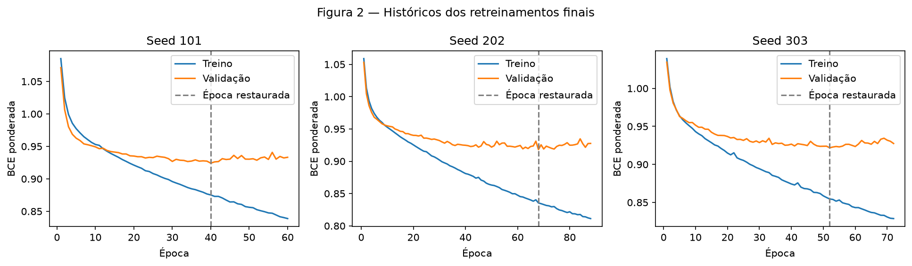
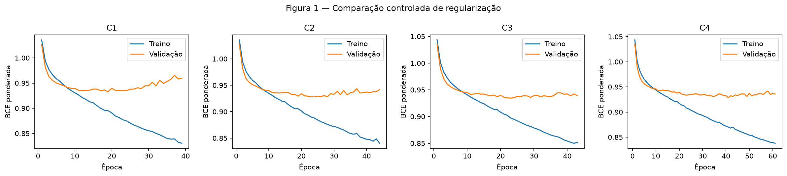
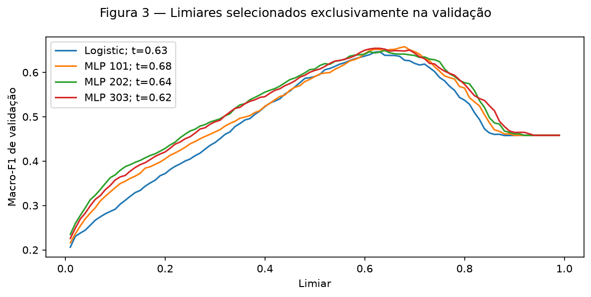
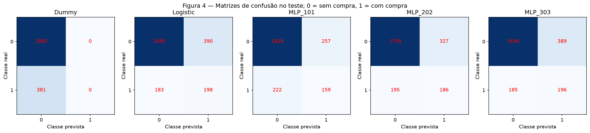
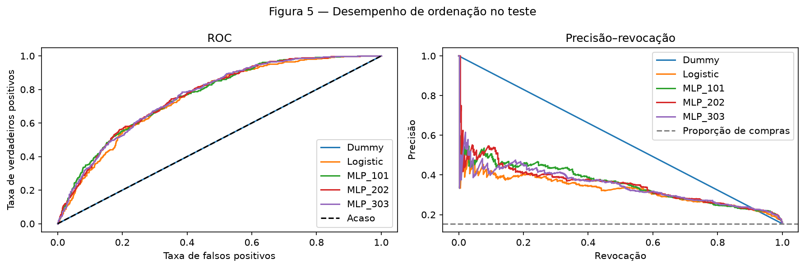
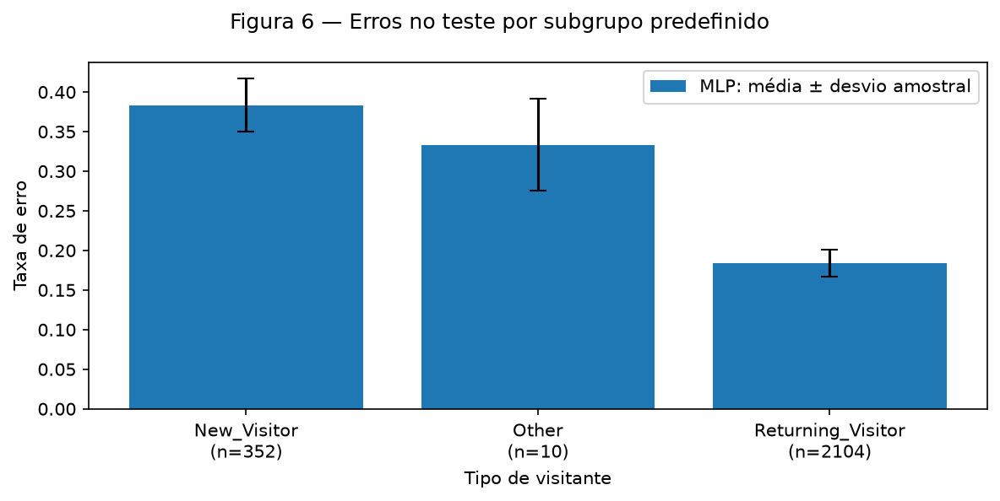
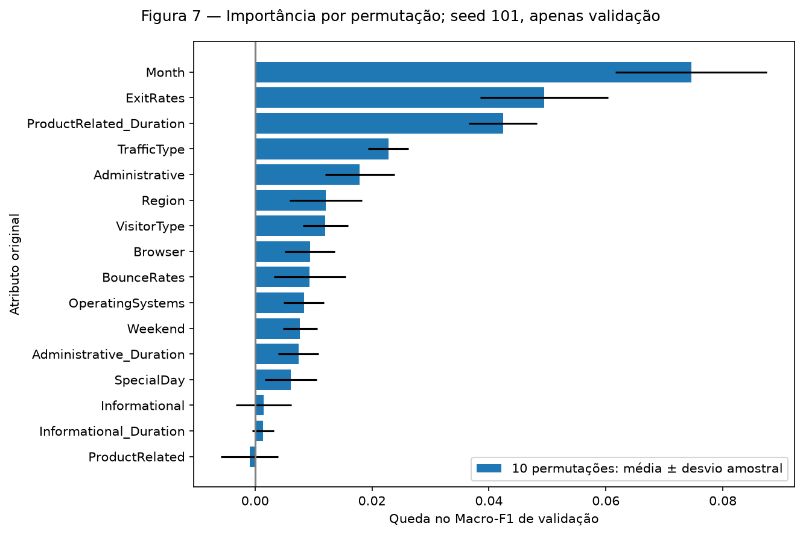

# Online Shoppers — Classificação com rede neural

## 0 — Ponto de partida

Damos continuidade à [EDA](../eda/index.md) da base UCI Online Shoppers Purchasing Intention: 12.330 sessões registradas, com `Revenue=True` indicando compra. As 1.908 compras representam 15,474453% da base. Trata-se de classificação retrospectiva de sessões; o CSV não permite afirmar que todos os atributos estariam disponíveis antes da compra em uma sessão ao vivo.

`train.py` importa o módulo original da EDA. As nove variáveis numéricas recebem imputação pela mediana e padronização; as sete categóricas recebem imputação pela moda e codificação one-hot densa. `PageValues` permanece excluída porque sua disponibilidade temporal não está esclarecida, sem que isso comprove vazamento. Não acrescentamos engenharia de atributos, redução de dimensionalidade, remoção de extremos ou reamostragem. A representação tem **74 entradas**. Não havia feedback externo de correção disponível.

Preservamos o primeiro particionamento original de `StratifiedGroupKFold(5, shuffle=True, random_state=42)`. Hashes dos 16 preditores retidos mantêm vetores idênticos no mesmo grupo. O primeiro particionamento de uma segunda aplicação, com os mesmos parâmetros, divide apenas as 9.864 sessões do treino original:

| Conjunto | Linhas | Sem compra | Com compra |
| --- | --- | --- | --- |
| Treino interno | 7891 | 6669 | 1222 |
| Validação | 1973 | 1668 | 305 |
| Teste original | 2466 | 2085 | 381 |

O pré-processamento é ajustado novamente **somente nas 7.891 linhas do treino interno**. Validação e teste recebem apenas `transform`. A EDA já havia inspecionado as contagens do teste e a integridade das transformações; nenhuma predição de teste orientou a seleção de modelos. `prepare` reconstrói a divisão original; os carregadores usados nas etapas seguintes de treinamento recusam pedidos de linhas do teste.

**Métrica principal pré-registrada:** Macro-F1, a média sem ponderação dos F1 das duas classes. **Sucesso:** a média do Macro-F1 de teste das três seeds da MLP, menos o maior Macro-F1 de teste dos dois baselines fixos, deve ser **pelo menos 0,02 em valor absoluto**. O critério foi salvo antes do treinamento e não foi revisado. Precisão ou F1 indefinidos para uma classe são registrados como zero.

Consulte o [protocolo com os índices exatos](artifacts/protocol.json), as [escolhas congeladas](artifacts/frozen.json), os [resultados numéricos completos](artifacts/results.json), o [histórico por época](artifacts/history.csv) e as [predições de teste salvas](artifacts/test_predictions.csv). O SHA-256 dos índices de teste é `c89e8f23df3e55bc5af85208983c2ffca78e0a3b7264fbcc72a5347f481c9f87` (índices ordenados, inteiros de 64 bits little-endian).

## 1 — Modelos de referência (baselines)

Os dois baselines usam o mesmo pré-processamento ajustado e as mesmas linhas de treino interno. `DummyClassifier(strategy="most_frequent")` sempre prevê ausência de compra. A regressão logística usa `lbfgs`, regularização L2 com `C=1`, tolerância `1e-4` e limite de 2.000 iterações; convergiu sem aviso de falha de convergência. Os pesos das classes são `{0: 1, 1: 6669/1222}`. Não fizemos busca de hiperparâmetros desse modelo.

| Modelo | Limiar | Macro-F1 de validação | Macro-F1 em 0,5 | Precisão de compras | Revocação de compras | Acurácia |
| --- | --- | --- | --- | --- | --- | --- |
| Dummy | 0.500000 | 0.458116 | 0.458116 | 0.000000 | 0.000000 | 0.845413 |
| Logistic | 0.630000 | 0.646574 | 0.590858 | 0.359202 | 0.531148 | 0.781044 |

A acurácia de validação de 0,845413 do Dummy esconde revocação zero para compras. A regressão logística aumenta o Macro-F1 para 0,646574, com revocação de compras de 0,531148 e precisão de 0,359202. Por isso, é a referência linear relevante.

Os limiares de decisão maximizam o Macro-F1 de validação entre 0,01 e 0,99, em passos de 0,01. Empates favorecem o valor mais próximo de 0,5 e, depois, o maior valor. Aplicamos o mesmo procedimento à MLP; o Dummy mantém a decisão pela classe majoritária. Não há custos comerciais quantificados: um falso positivo identifica uma sessão sem compra como compradora; um falso negativo deixa de identificar uma compra. Macro-F1 atribui o mesmo peso às classes, mas não representa uma função de custo monetário. Se o modelo orientasse uma oferta, FP poderia desperdiçar contatos e FN poderia deixar de alcançar um cliente relevante; esse uso não foi testado.

## 2 — Rede neural

A rede selecionada é **74 → 32 → 1**, com ReLU e dropout de 0,20 após a camada oculta. Uma única camada oculta permite interações não lineares com capacidade pequena em relação às 7.891 linhas de treino. São **2.433 parâmetros treináveis**: `(74+1)×32 + (32+1)×1`, ou 0,3083 parâmetro por linha de treino. As alternativas com 64 unidades e com camadas de 32–16 unidades têm 4.865 e 2.945 parâmetros, respectivamente; a contagem de parâmetros, isoladamente, não garante generalização.

Os pesos ocultos usam inicialização Kaiming normal para ReLU; a saída linear usa Xavier uniforme com ganho 1; os vieses começam em zero. O modelo retorna um logit por sessão. `BCEWithLogitsLoss(pos_weight=5.457447)` combina um cálculo estável de sigmoid e entropia cruzada com a razão entre negativos e positivos calculada apenas no treino, **6669/1222**. Aplicamos sigmoid somente para obter os escores de predição. Os escores da perda ponderada não são apresentados como probabilidades de compra calibradas.

A arquitetura e o laço de retropropagação foram implementados diretamente em PyTorch, sem `MLPClassifier` nem framework de treinamento.

## 3 — Treinamento

Adam usa taxa de aprendizado **0,001**, betas `(0.9, 0.999)`, epsilon `1e-8`, lotes de **128** exemplos e no máximo **200 épocas**. As atualizações adaptativas são adequadas à representação tabular mista; 128 permite lotes pequenos e baratos em CPU. A taxa de aprendizado é constante. O weight decay é **0,001**, com a penalização acoplada do Adam aplicada a todos os parâmetros treináveis, incluindo vieses; não se trata de AdamW.

A parada antecipada acompanha a BCE ponderada de validação, aguarda **20 épocas sem melhora estrita** e restaura os pesos da menor perda. As perdas de treino e validação de cada época são calculadas em modo de avaliação, com dropout desligado e sem adicionar a penalização de pesos do otimizador à perda exibida. Assim, as duas curvas são comparáveis. Fixamos as seeds de Python, NumPy e PyTorch, uma thread de CPU, operações determinísticas do PyTorch e um gerador separado com seed fixa para embaralhar os lotes.

| Seed final | Melhor época | Época de parada | BCE de validação restaurada | Limiar de validação | Macro-F1 de validação |
| --- | --- | --- | --- | --- | --- |
| 101 | 40 | 60 | 0.924189 | 0.680000 | 0.657901 |
| 202 | 68 | 88 | 0.918129 | 0.640000 | 0.649675 |
| 303 | 52 | 72 | 0.921867 | 0.620000 | 0.654286 |



Na seed 101, a BCE de validação cai de **1,071266** na época 1 para **0,924189** na época 40. Na época 60, sobe para **0,933214**, enquanto a BCE de treino cai de **0,875218**, na época 40, para **0,838829**. O aumento dessa diferença sustenta a interpretação de sobreajuste após o melhor checkpoint, embora haja oscilações entre épocas. As seeds 202 e 303 também param 20 épocas após seus mínimos, nas épocas 88 e 72; os pesos restaurados são das épocas 68 e 52. Nenhuma execução atingiu o teto de 200 épocas, e não houve falha numérica ou de convergência.

## 4 — Regularização e hiperparâmetros

Avaliamos oito configurações com seed **42**, mantendo a divisão dos dados, o pré-processamento, o peso da classe positiva, a ordem dos lotes e a regra de parada. O controle não usa dropout nem weight decay; a parada antecipada é comum a todas as execuções e também restringe o ajuste. C2 e C3 isolam cada técnica; C4 combina as duas. C5–C6 variam a taxa de aprendizado, C7 varia a largura e C8 a profundidade.

A tabela está ordenada pelo Macro-F1 de validação, após restaurar o checkpoint e selecionar seu limiar. Em caso de empate, a preferência seria por menos parâmetros, menor BCE de validação do checkpoint e, por fim, menor identificador de configuração.

| Posição | ID | Unidades ocultas | Taxa de aprendizado | Weight decay | Dropout | Parâmetros | Limiar | Macro-F1 | F1 em 0,5 | Melhor época / parada |
| --- | --- | --- | --- | --- | --- | --- | --- | --- | --- | --- |
| 1 | C4 | 32 | 0.001000 | 0.001000 | 0.200000 | 2433 | 0.640000 | 0.652544 | 0.599945 | 41 / 61 |
| 2 | C7 | 64 | 0.001000 | 0.000000 | 0.000000 | 4865 | 0.640000 | 0.650323 | 0.593400 | 19 / 39 |
| 3 | C5 | 32 | 0.000300 | 0.000000 | 0.000000 | 2433 | 0.630000 | 0.649311 | 0.592092 | 51 / 71 |
| 4 | C6 | 32 | 0.003000 | 0.000000 | 0.000000 | 2433 | 0.720000 | 0.647169 | 0.578062 | 8 / 28 |
| 5 | C8 | 32–16 | 0.001000 | 0.000000 | 0.000000 | 2945 | 0.690000 | 0.646266 | 0.579030 | 19 / 39 |
| 6 | C2 | 32 | 0.001000 | 0.001000 | 0.000000 | 2433 | 0.650000 | 0.646200 | 0.590899 | 24 / 44 |
| 7 | C1 | 32 | 0.001000 | 0.000000 | 0.000000 | 2433 | 0.680000 | 0.644171 | 0.579684 | 19 / 39 |
| 8 | C3 | 32 | 0.001000 | 0.000000 | 0.200000 | 2433 | 0.670000 | 0.641640 | 0.595190 | 23 / 43 |



Em relação ao Macro-F1 **0,644171** de C1 com limiar ajustado, o weight decay isolado altera o resultado em **+0,002029**, o dropout isolado em **−0,002531**, e a combinação em **+0,008372**. No limiar comum de 0,5, C1–C4 obtêm **0,579684, 0,590899, 0,595190 e 0,599945**. Assim, o dropout isolado ajuda no limiar fixo, mas não melhora o resultado com limiar ajustado. C4 vence com **0,652544**, apenas **0,005970** acima do Macro-F1 de validação da logística. Uma única seed de busca controla a comparação, mas não estabelece superioridade estatística de um regularizador.

C4 foi então retreinada do zero com seeds **101, 202 e 303**. Treino interno e validação permanecem separados; a validação não foi incorporada ao treino. Cada seed tem seu próprio checkpoint restaurado e limiar escolhido na validação. Os baselines foram reajustados nas mesmas linhas de treino. Não selecionamos a melhor seed nem combinamos as redes em um ensemble.



Os limiares congelados são **0,68, 0,64 e 0,62** para as três seeds da MLP e **0,63** para a regressão logística. A validação é reutilizada para arquitetura, parada antecipada e escolha do limiar; por isso, seu desempenho pode ser otimista. O teste reservado avalia o procedimento completo já fixado.

## 5 — Avaliação no teste

Os três checkpoints, os limiares, os baselines, o pré-processamento, os hashes dos códigos e o critério de sucesso foram congelados **antes da inferência no teste**. O SHA-256 do manifesto original é `8d68e0d2349b769f86f09f0517340dc32d69c47614e91da5227eaa8fe1fc1908`. `evaluate.py` verifica os hashes e avalia cada modelo congelado nas mesmas 2.466 linhas de teste. A geração posterior das figuras usa as predições salvas, sem retreinar ou selecionar modelos. A reprodução em ambiente limpo repetiu o protocolo sem alterações para verificar os resultados. A migração posterior para `project/` e a tradução dos gráficos estão registradas no manifesto atual; o [manifesto original](artifacts/frozen-original.json) permanece preservado. Essas alterações de apresentação não modificaram modelos, limiares nem predições.

| Modelo | Macro-F1 | ROC-AUC | PR-AUC (trapezoidal) | Precisão média (AP) | Acurácia |
| --- | --- | --- | --- | --- | --- |
| Dummy | 0.458141 | 0.500000 | 0.577251 | 0.154501 | 0.845499 |
| Logistic | 0.632041 | 0.754716 | 0.325235 | 0.327075 | 0.767640 |
| MLP_101 | 0.641578 | 0.765708 | 0.354728 | 0.356607 | 0.805758 |
| MLP_202 | 0.643418 | 0.765985 | 0.350974 | 0.352603 | 0.788321 |
| MLP_303 | 0.630533 | 0.765388 | 0.344598 | 0.346461 | 0.767234 |
| MLP: média ± desvio amostral | 0.638510 ± 0.006969 | 0.765694 ± 0.000299 | 0.350100 ± 0.005121 | 0.351890 ± 0.005111 | 0.787105 ± 0.019291 |

A classe 0 indica ausência de compra (suporte **2.085**); a classe 1 indica compra (suporte **381**). A tabela apresenta os resultados individuais dos modelos, sem combinar suas predições:

| Modelo | Classe | Precisão | Revocação | F1 | Suporte |
| --- | --- | --- | --- | --- | --- |
| Dummy | 0 | 0.845499 | 1.000000 | 0.916282 | 2085 |
| Dummy | 1 | 0.000000 | 0.000000 | 0.000000 | 381 |
| Logistic | 0 | 0.902556 | 0.812950 | 0.855413 | 2085 |
| Logistic | 1 | 0.336735 | 0.519685 | 0.408669 | 381 |
| MLP_101 | 0 | 0.891707 | 0.876739 | 0.884160 | 2085 |
| MLP_101 | 1 | 0.382212 | 0.417323 | 0.398996 | 381 |
| MLP_202 | 0 | 0.900154 | 0.843165 | 0.870728 | 2085 |
| MLP_202 | 1 | 0.362573 | 0.488189 | 0.416107 | 381 |
| MLP_303 | 0 | 0.901648 | 0.813429 | 0.855270 | 2085 |
| MLP_303 | 1 | 0.335043 | 0.514436 | 0.405797 | 381 |

| MLP agregada | Classe 0: média ± desvio | Classe 1: média ± desvio |
| --- | --- | --- |
| Precisão | 0.897836 ± 0.005360 | 0.359942 ± 0.023694 |
| Revocação | 0.844444 ± 0.031674 | 0.473316 ± 0.050236 |
| F1 | 0.870052 ± 0.014457 | 0.406967 ± 0.008615 |





**O critério de sucesso não foi atingido:** a média do Macro-F1 da MLP, **0,638510 ± 0,006969**, menos o resultado da logística, **0,632041**, é **0,006469**, abaixo dos **0,02** pré-registrados. O ganho também é menor que o desvio entre seeds, e a seed 303 fica abaixo da logística. Não há evidência de uma vantagem consistente. O desvio descreve a variabilidade do treinamento e do limiar em uma divisão fixa; não é um intervalo de confiança para clientes futuros.

A revocação de compras tem média **0,473316 ± 0,050236**, abaixo dos **0,519685** da logística; a precisão de compras tem média **0,359942 ± 0,023694**, acima dos **0,336735** da logística. A rede deixa de identificar algumas compras em troca de menos falsos positivos. O Dummy tem a maior acurácia, **0,845499**, mas deixa de identificar todas as compras.

PR-AUC usa integração trapezoidal da curva empírica de precisão–revocação. Apresentamos Average Precision (AP, precisão média) separadamente, pois seu cálculo não usa a mesma interpolação. Os escores constantes do Dummy produzem PR-AUC trapezoidal **0,577251**, mas AP **0,154501**, exatamente a proporção de compras no teste. Essa área interpolada não deve ser interpretada como melhor capacidade de ordenação. A AP da MLP, **0,351890 ± 0,005111**, supera a da logística, **0,327075**; esse resultado secundário não altera a conclusão sobre o critério principal.

## 6 — Análise de erros

### Subgrupo definido previamente: tipo de visitante

O erro é `(FP + FN) / número de linhas do subgrupo`. Os suportes e as contagens de compras abaixo são fixos; a média e o desvio do erro usam as três redes. `Other` tem apenas dez sessões de teste, tornando sua estimativa especialmente instável.

| Tipo de visitante | Linhas | Compras | Erro médio | Desvio do erro | Precisão média de compras | Revocação média de compras |
| --- | --- | --- | --- | --- | --- | --- |
| New_Visitor | 352 | 92 | 0.383523 | 0.033494 | 0.359524 | 0.586957 |
| Other | 10 | 2 | 0.333333 | 0.057735 | 0.000000 | 0.000000 |
| Returning_Visitor | 2104 | 287 | 0.183777 | 0.017033 | 0.361529 | 0.440186 |

| Modelo | Tipo de visitante | FP | FN | Precisão de compras | Revocação de compras |
| --- | --- | --- | --- | --- | --- |
| Logistic | New_Visitor | 137 | 35 | 0.293814 | 0.619565 |
| Logistic | Other | 1 | 0 | 0.666667 | 1.000000 |
| Logistic | Returning_Visitor | 252 | 148 | 0.355499 | 0.484321 |
| MLP_101 | New_Visitor | 79 | 43 | 0.382812 | 0.532609 |
| MLP_101 | Other | 1 | 2 | 0.000000 | 0.000000 |
| MLP_101 | Returning_Visitor | 177 | 177 | 0.383275 | 0.383275 |
| MLP_202 | New_Visitor | 101 | 37 | 0.352564 | 0.597826 |
| MLP_202 | Other | 1 | 2 | 0.000000 | 0.000000 |
| MLP_202 | Returning_Visitor | 225 | 156 | 0.367978 | 0.456446 |
| MLP_303 | New_Visitor | 111 | 34 | 0.343195 | 0.630435 |
| MLP_303 | Other | 2 | 2 | 0.000000 | 0.000000 |
| MLP_303 | Returning_Visitor | 276 | 149 | 0.333333 | 0.480836 |



**Novos visitantes apresentam o maior erro médio: 0,383523 ± 0,033494 (352 sessões)**, contra 0,183777 ± 0,017033 entre recorrentes (2.104 sessões). Sua proporção de compras no teste é maior (92/352), em concordância com a EDA. Uma hipótese é que o modelo classifique padrões de navegação desse grupo como compra de forma excessivamente abrangente: a seed 101 tem **79 FP e 43 FN** entre novos visitantes. Recorrentes contribuem com **177 FP e 177 FN**, em parte porque são um grupo muito maior. `Other` apresenta erro médio **0,333333 ± 0,057735** em apenas dez linhas; suas duas compras não são identificadas por nenhuma das três redes. A baixa cobertura de treino é uma hipótese plausível, não uma causa confirmada.

### Exemplos incorretos com escores mais extremos

A seed **101** foi designada antes do teste. Abaixo estão seus cinco FP de maior escore e cinco FN de menor escore; empates seguem a ordem original das linhas. Os escores vêm do modelo com perda ponderada e não representam confiança calibrada. O limiar é **0,68**. Os identificadores são os índices originais do CSV, começando em zero.

| Linha | Erro | Real | Previsto | Escore | Tipo de visitante | Mês | Taxa de saída | Duração em produtos |
| --- | --- | --- | --- | --- | --- | --- | --- | --- |
| 3476 | FP | 0 | 1 | 0.905029 | New_Visitor | May | 0.003922 | 1723.000000 |
| 8037 | FP | 0 | 1 | 0.898694 | New_Visitor | Nov | 0.000446 | 475.025000 |
| 12141 | FP | 0 | 1 | 0.892265 | Returning_Visitor | Nov | 0.023353 | 12003.317580 |
| 11130 | FP | 0 | 1 | 0.890022 | Returning_Visitor | Nov | 0.020194 | 16138.290800 |
| 11477 | FP | 0 | 1 | 0.881928 | Returning_Visitor | Nov | 0.012826 | 10497.154430 |
| 4407 | FN | 1 | 0 | 0.011774 | Returning_Visitor | May | 0.077193 | 421.600000 |
| 7600 | FN | 1 | 0 | 0.042729 | Returning_Visitor | Nov | 0.200000 | 0.000000 |
| 11955 | FN | 1 | 0 | 0.068739 | Returning_Visitor | Dec | 0.075000 | 329.250000 |
| 5592 | FN | 1 | 0 | 0.112255 | Returning_Visitor | Sep | 0.064912 | 420.246667 |
| 10255 | FN | 1 | 0 | 0.126869 | Returning_Visitor | Dec | 0.060000 | 26.000000 |

Quatro dos cinco FP ocorreram em novembro, e três FP de visitantes recorrentes têm duração em páginas de produtos acima de 10.000, na unidade de tempo não especificada pela fonte. O modelo pode confundir atividade intensa de navegação com conversão. Os cinco FN são recorrentes com taxas de saída de pelo menos 0,06; a linha 7600 tem duração em produtos igual a zero, apesar da compra. Uma hipótese é que as associações aprendidas entre menor taxa de saída, navegação mais longa e compra falhem nessas sessões. Os exemplos não comprovam rótulos incorretos nem mecanismos causais; motivam uma investigação futura sobre qualidade e disponibilidade temporal dos atributos, sem alterar este experimento.

### Importância por permutação na validação

Antes de abrir o teste, permutamos cada uma das **16 colunas originais retidas** dez vezes na validação, com seed **42**, o checkpoint da seed 101 e seu limiar congelado. O pipeline já ajustado transforma cada tabela permutada; assim, todos os indicadores one-hot de uma variável categórica mudam em conjunto. A importância é a queda no Macro-F1 de validação; não houve seleção de atributos baseada no teste.

| Atributo original | Queda média de F1 | Desvio entre permutações |
| --- | --- | --- |
| Month | 0.074603 | 0.012949 |
| ExitRates | 0.049461 | 0.010908 |
| ProductRelated_Duration | 0.042402 | 0.005803 |
| TrafficType | 0.022799 | 0.003486 |
| Administrative | 0.017918 | 0.005946 |
| Region | 0.012117 | 0.006156 |
| VisitorType | 0.012018 | 0.003885 |
| Browser | 0.009382 | 0.004245 |
| BounceRates | 0.009364 | 0.006147 |
| OperatingSystems | 0.008343 | 0.003479 |
| Weekend | 0.007692 | 0.002936 |
| Administrative_Duration | 0.007410 | 0.003466 |
| SpecialDay | 0.006076 | 0.004440 |
| Informational | 0.001483 | 0.004709 |
| Informational_Duration | 0.001350 | 0.001866 |
| ProductRelated | -0.000901 | 0.004905 |



As maiores quedas são **Month 0,074603**, **ExitRates 0,049461** e **ProductRelated_Duration 0,042402**, em concordância com as associações de sazonalidade, taxa de saída e duração de navegação encontradas na EDA. `VisitorType` contribui com **0,012018**. `ProductRelated` tem uma estimativa ligeiramente negativa (**−0,000901 ± 0,004905**); sua correlação de 0,883155 com a duração em produtos, observada na EDA, torna plausível a redundância preditiva. Importância pequena ou negativa não prova que uma variável seja inútil. Correlações e combinações pouco realistas produzidas pela permutação limitam o diagnóstico; nenhum desses valores estabelece causalidade.

## 7 — Conclusão

A MLP pequena aprende algum sinal não linear de ordenação, mas **não justifica substituir a regressão logística pelo critério pré-registrado**. Seu ganho de Macro-F1 é 0,006469, abaixo tanto da meta de 0,02 quanto do desvio das três seeds. A regressão logística permanece como a referência mais simples para esta base e representação.

As limitações incluem uma única divisão aleatória com grupos, reutilização da validação, apenas três seeds finais, categorias raras, atributos correlacionados e incerteza sobre a disponibilidade dos agregados antes da compra. O CSV não permite estabelecer generalização cronológica nem valor de uma intervenção em tempo real. Os resultados não sustentam uma política causal de ofertas. Falsos positivos poderiam desperdiçar contatos; falsos negativos poderiam deixar compradores de fora, com um equilíbrio diferente entre erros conforme o tipo de visitante.

Com mais tempo, verificaríamos primeiro os instantes de disponibilidade dos atributos e obteríamos um conjunto temporal coletado de forma independente; depois, quantificaríamos os custos reais de intervenção. Novos modelos ou estudos de calibração exigiriam um novo protocolo de avaliação, sem ajustes orientados por este teste.

### Reprodução e verificação

A partir da raiz do repositório, com Python 3.12 e CPU:

```bash
unset PYTHONPATH
python3.12 -m venv .venv
source .venv/bin/activate
python -m pip install -r requirements.txt
python -m pip check
python docs/project/classification/code/train.py prepare
python -m unittest discover -s docs/project/classification/code -p 'test_*.py'
python docs/project/classification/code/train.py search
python docs/project/classification/code/train.py freeze
python docs/project/classification/code/evaluate.py run
python docs/project/classification/code/evaluate.py render
python -m unittest discover -s docs/project/classification/code -p 'test_*.py'
mkdocs build --strict
```

A execução padrão fica em `.cache/classification/`. `prepare`, `search` e `freeze` recusam sobrescrever etapas concluídas. Para repetir, passe o mesmo novo `--run-dir .cache/classification-reproduction` a todas as etapas. Execuções alternativas não sobrescrevem os artefatos do relatório; suas figuras ficam no diretório da própria execução. Predições de teste existentes são preservadas em avaliações repetidas. Este experimento não exige executar novamente a EDA, calcular UMAP ou baixar dados. O SHA-256 original do CSV incluído no repositório é verificado. O comando de shell remove o `PYTHONPATH` externo do ROS encontrado no ambiente de desenvolvimento, sem remover uma dependência do projeto.

Uma reprodução em ambiente novo produziu protocolo, manifesto de congelamento, resultados, histórico por época e predições de teste idênticos byte a byte; veja as [evidências de verificação](artifacts/verification.json). A suíte final passou nos oito testes e os builds estritos do MkDocs foram aprovados. Essa verificação corresponde à execução original, anterior à tradução e à migração dos caminhos. Os artefatos científicos registram os valores com precisão completa; as tabelas arredondam para seis casas decimais e mantêm o ponto como separador decimal para facilitar a comparação com os arquivos. Consulte o [código de treinamento](code/train.py), o [código de avaliação](code/evaluate.py) e os [testes](code/test_classification.py).

### Referências

- [Enunciado oficial do projeto supervisionado, 2026.2](https://insper.github.io/ann-dl/2026.2/projects/supervised/), consultado em 3 de novembro de 2026; a rubrica ainda estava marcada como sujeita a revisão.
- [Enunciado da EDA](https://insper.github.io/ann-dl/2026.2/projects/eda/) e [regras de submissão](https://insper.github.io/ann-dl/2026.2/exercises/submission/).
- [UCI Online Shoppers Purchasing Intention](https://archive.ics.uci.edu/dataset/468/online+shoppers+purchasing+intention+dataset), Sakar and Kastro (2018), CC BY 4.0, DOI 10.24432/C5F88Q.
- [PyTorch BCEWithLogitsLoss](https://docs.pytorch.org/docs/2.10/generated/torch.nn.BCEWithLogitsLoss.html), [Adam](https://docs.pytorch.org/docs/2.10/generated/torch.optim.Adam.html), e [scikit-learn Average Precision](https://scikit-learn.org/stable/modules/generated/sklearn.metrics.average_precision_score.html).

### Código executável de treinamento

```python
--8<-- "docs/project/classification/code/train.py"
```

### Código executável de avaliação

```python
--8<-- "docs/project/classification/code/evaluate.py"
```

### Testes de validação

```python
--8<-- "docs/project/classification/code/test_classification.py"
```

## Resumo dos resultados

| # | Resultado | Valor |
| --- | --- | --- |
| 1 | Dataset, tarefa, alvo e métrica principal | UCI Online Shoppers; classificação binária; Revenue; Macro-F1 |
| 2 | Treino · validação · teste (linhas) | 7.891 · 1.973 · 2.466; os dois primeiros dividem as 9.864 linhas do treino original |
| 3 | Melhor baseline e sua métrica de teste | Regressão logística; Macro-F1 0.632041 |
| 4 | Rede escolhida: camadas × unidades, parâmetros e regularização | 74 → 32 → 1; 2.433 parâmetros; weight decay 0.001, dropout 0.20 |
| 5 | Otimizador, taxa de aprendizado, lote e época de parada | Adam; 0.001; 128; parada 60 / 88 / 72 (seeds 101 / 202 / 303), restauração 40 / 68 / 52 |
| 6 | Métrica principal da rede no teste (média ± desvio, 3 seeds) | 0.638510 ± 0.006969 |
| 7 | Critério de sucesso atingido? | Não: ganho 0.006469 < mínimo exigido 0.020000 |
| 8 | Subgrupo com maior erro e seu valor | New_Visitor: erro médio 0.383523 ± 0.033494; n=352 |
