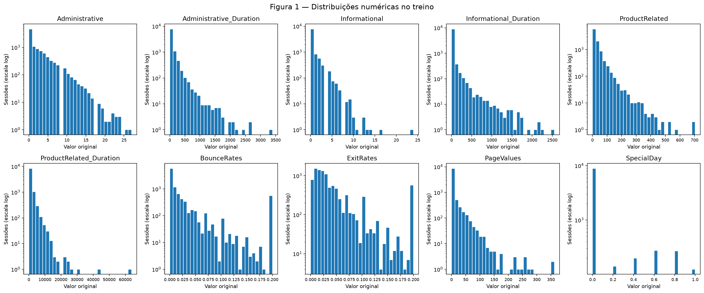
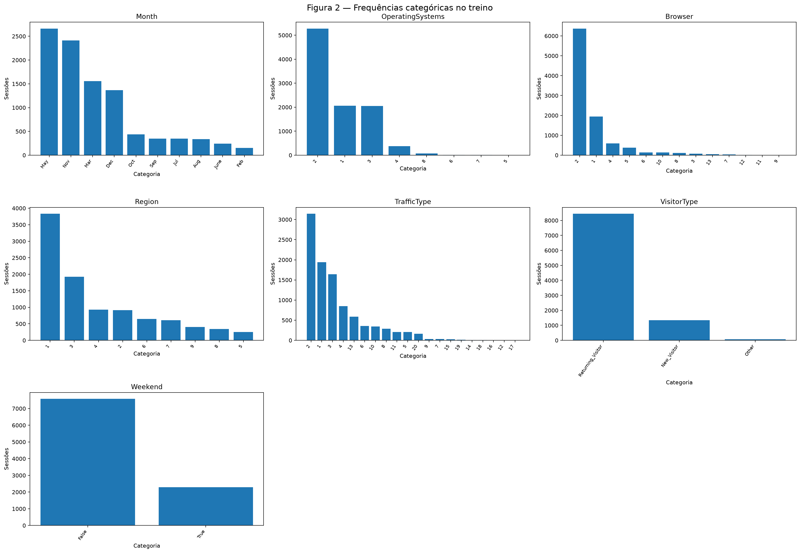
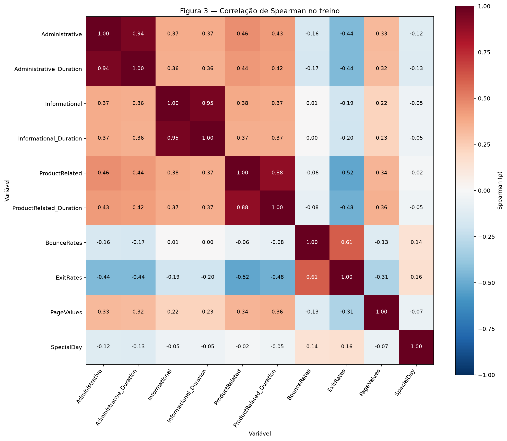
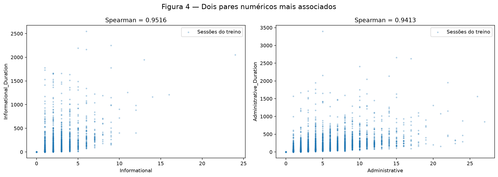
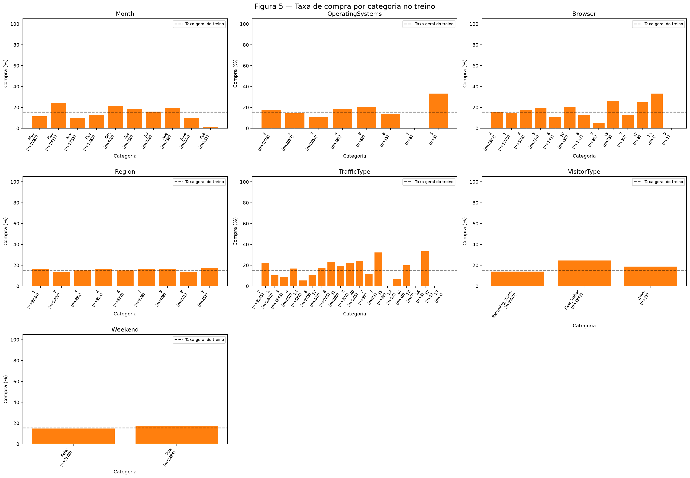
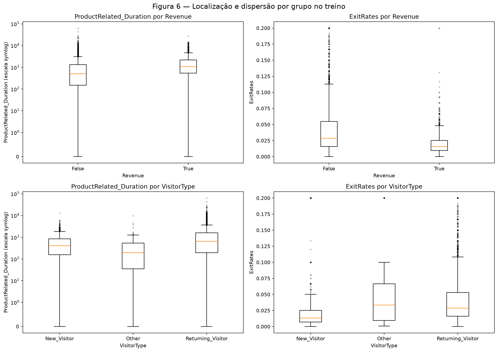
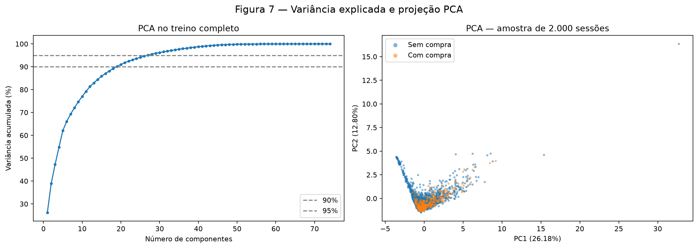
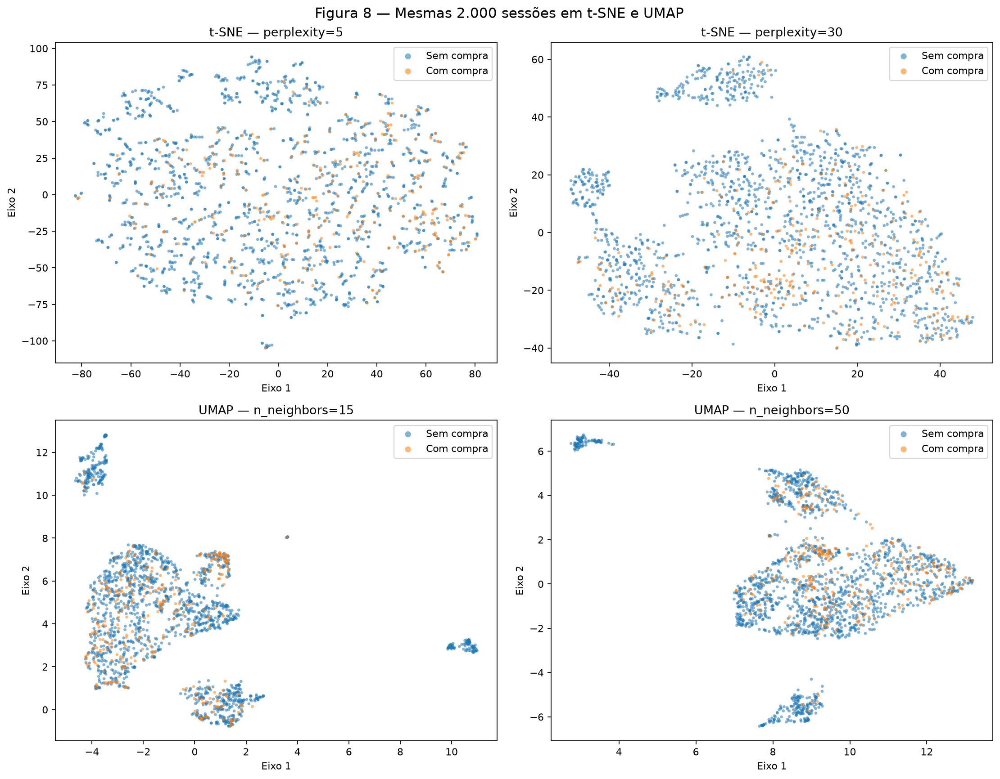

# EDA — Online Shoppers Purchasing Intention

**Equipe:** Daniel Marco Djanikian, Stefano Metne Lindenbojm e Felipe Frug Mauro.

Investigamos como as características de uma sessão de loja virtual se relacionam
com a ocorrência de compra, indicada por `Revenue`. Esta entrega contém EDA e
pré-processamento para classificação binária. Não treinamos classificadores nem
estimamos desempenho preditivo. PCA, t-SNE e UMAP são análises exploratórias.

O relatório segue o [enunciado da EDA](https://insper.github.io/ann-dl/2026.2/projects/eda/)
e o [formato de submissão](https://insper.github.io/ann-dl/2026.2/exercises/submission/).
As tabelas foram calculadas pelo [arquivo Python executável](code/eda.py), com
seed 42. Para reproduzir em Python 3.12, com as dependências do `requirements.txt`:

```bash
python docs/projects/eda/code/eda.py > /tmp/eda-resultados.md
mkdocs build --strict
```

O script imprime as tabelas em Markdown, gera as oito figuras e valida o pipeline.
Ele não sobrescreve este texto. Estatísticas descritivas usam o treino, exceto
onde a população está explicitamente identificada como base completa ou teste.
Valores nas tabelas podem estar arredondados; os cálculos usam precisão completa.
Clique nas figuras para abrir os arquivos em resolução completa.

## 0 — Proposta

**Aprovação:** a equipe confirmou que o professor aprovou esta base.
O repositório da equipe é [DanielMarcoD/redesneurais](https://github.com/DanielMarcoD/redesneurais).

Usamos o [Online Shoppers Purchasing Intention Dataset da UCI](https://archive.ics.uci.edu/dataset/468/online+shoppers+purchasing+intention+dataset),
de Sakar e Kastro (2018), DOI [10.24432/C5F88Q](https://doi.org/10.24432/C5F88Q).
A base é pública, tabular, tem 12.330 sessões, 17 preditoras e o alvo no próprio
arquivo. São dez preditoras numéricas e sete categóricas; a oitava categórica
mencionada pela documentação é o próprio alvo. A base atende aos mínimos de
1.000 instâncias e cinco atributos numéricos/categóricos e foi aprovada para este
projeto.

A motivação é descrever diferenças de navegação entre sessões com e sem compra e
preparar uma entrada simples para uma futura rede neural. Os primeiros riscos são
o desbalanceamento do alvo e a possibilidade de atributos derivados incorporarem
informações indisponíveis antes do desfecho. A mesma base será mantida na entrega
posterior de classificação.

O CSV bruto está versionado em `data/online-shoppers/online_shoppers_intention.csv`.
Foi obtido do [ZIP oficial](https://archive.ics.uci.edu/static/public/468/online+shoppers+purchasing+intention+dataset.zip),
sem alterar seus bytes. A licença é **CC BY 4.0**, com atribuição aos autores e à
UCI. O carregamento verifica o SHA-256:

```text
b3055ee355f59134d851d32641183cb4a8b45def7124d2f50442a042f358e0d9
```

## 1 — Inspeção inicial

### A — Origem e dicionário de dados

Cada linha representa uma sessão de navegação. Segundo a UCI, as sessões foram
selecionadas para corresponder a usuários distintos ao longo de um ano. O CSV não
contém identificador de usuário nem data completa que permita confirmar essa
informação por registro ou reconstruir uma ordem cronológica.

**Tabela 1 — Dicionário completo.** Os tipos abaixo são semânticos. Nas durações,
a unidade temporal não é explicitada na documentação consultada; não presumimos
segundos. Nos códigos nominais, não inventamos correspondências para sistemas,
navegadores, regiões ou fontes de tráfego.

| Coluna | Significado | Papel e tipo semântico | Unidade / domínio |
| --- | --- | --- | --- |
| `Administrative` | Páginas administrativas visitadas na sessão | Preditor numérico discreto | Contagem de páginas |
| `Administrative_Duration` | Tempo acumulado em páginas administrativas | Preditor numérico contínuo | Unidade temporal não informada |
| `Informational` | Páginas informativas visitadas na sessão | Preditor numérico discreto | Contagem de páginas |
| `Informational_Duration` | Tempo acumulado em páginas informativas | Preditor numérico contínuo | Unidade temporal não informada |
| `ProductRelated` | Páginas relacionadas a produtos visitadas na sessão | Preditor numérico discreto | Contagem de páginas |
| `ProductRelated_Duration` | Tempo acumulado em páginas de produtos | Preditor numérico contínuo | Unidade temporal não informada |
| `BounceRates` | Métrica de rejeição das páginas visitadas: entrada seguida de saída sem nova requisição | Preditor numérico contínuo | Taxa, fração adimensional |
| `ExitRates` | Métrica de saída das páginas visitadas: proporção de visualizações que encerram a sessão | Preditor numérico contínuo | Taxa, fração adimensional |
| `PageValues` | Valor médio atribuído às páginas visitadas antes de uma transação | Numérico contínuo; excluído do pipeline | Unidade monetária não informada |
| `SpecialDay` | Proximidade da visita a uma data comercial especial | Preditor numérico discreto | Escala adimensional de 0 a 1 |
| `Month` | Mês da sessão | Preditor categórico nominal neste pipeline | Rótulo de mês |
| `OperatingSystems` | Sistema operacional | Preditor categórico nominal | Código sem unidade |
| `Browser` | Navegador | Preditor categórico nominal | Código sem unidade |
| `Region` | Região do visitante | Preditor categórico nominal | Código sem unidade |
| `TrafficType` | Tipo de origem do tráfego | Preditor categórico nominal | Código sem unidade |
| `VisitorType` | Visitante novo, recorrente ou outro | Preditor categórico nominal | `New_Visitor`, `Returning_Visitor`, `Other` |
| `Weekend` | Sessão ocorreu no fim de semana | Preditor categórico binário | `False` / `True` |
| `Revenue` | Sessão resultou em compra | Alvo categórico binário | `False` / `True` |

As três durações são `float64` no CSV, inclusive as duas primeiras que aparecem
como inteiras em parte dos metadados da UCI. Os valores fracionários e o significado
de tempo motivam tratá-las como contínuas. `SpecialDay` possui seis valores
observados, mas sua escala de proximidade permite tratá-lo como quantitativo
discreto. O mês usa one-hot; não pressupomos distância linear entre seus rótulos.

### B — Qualidade e possíveis vazamentos

**Tabela 2 — Auditoria estrutural da base completa.**

| Coluna | Tipo no CSV | Ausentes | Ausentes (%) | Cardinalidade |
| --- | --- | --- | --- | --- |
| Administrative | int64 | 0 | 0 | 27 |
| Administrative_Duration | float64 | 0 | 0 | 3335 |
| Informational | int64 | 0 | 0 | 17 |
| Informational_Duration | float64 | 0 | 0 | 1258 |
| ProductRelated | int64 | 0 | 0 | 311 |
| ProductRelated_Duration | float64 | 0 | 0 | 9551 |
| BounceRates | float64 | 0 | 0 | 1872 |
| ExitRates | float64 | 0 | 0 | 4777 |
| PageValues | float64 | 0 | 0 | 2704 |
| SpecialDay | float64 | 0 | 0 | 6 |
| Month | str | 0 | 0 | 10 |
| OperatingSystems | int64 | 0 | 0 | 8 |
| Browser | int64 | 0 | 0 | 13 |
| Region | int64 | 0 | 0 | 9 |
| TrafficType | int64 | 0 | 0 | 20 |
| VisitorType | str | 0 | 0 | 3 |
| Weekend | bool | 0 | 0 | 2 |
| Revenue | bool | 0 | 0 | 2 |

Todas as colunas empatam em **zero ausentes (0%)**. As 18 colunas têm mais de um
valor: não há constantes. Não há uma coluna identificadora a remover.

**Tabela 3 — Verificações de domínio na base completa.**

| Verificação | Ocorrências |
| --- | --- |
| Administrative: negativo ou fracionário | 0 |
| Informational: negativo ou fracionário | 0 |
| ProductRelated: negativo ou fracionário | 0 |
| Administrative_Duration: negativo | 0 |
| Informational_Duration: negativo | 0 |
| ProductRelated_Duration: negativo | 0 |
| PageValues: negativo | 0 |
| BounceRates: fora de [0,1] | 0 |
| ExitRates: fora de [0,1] | 0 |
| SpecialDay: fora de [0,1] | 0 |
| Month: rótulo inesperado | 0 |
| VisitorType: rótulo inesperado | 0 |
| OperatingSystems: código não inteiro positivo | 0 |
| Browser: código não inteiro positivo | 0 |
| Region: código não inteiro positivo | 0 |
| TrafficType: código não inteiro positivo | 0 |
| Numéricas: valores não finitos, exceto ausentes | 0 |

Os códigos inteiros positivos foram verificados estruturalmente. A fonte não
fornece um catálogo completo que associe cada código a uma categoria real; por
isso, o teste não comprova que todo código positivo seja semanticamente correto.
Não há rótulos inesperados de mês ou tipo de visitante nas verificações adotadas.
Janeiro e abril não aparecem; isso não é ausência de um campo nem motivo para
fabricar sessões. Duração zero também não é considerada erro automaticamente.

**Tabela 4 — Repetições e constantes na base completa.**

| Indicador | Valor |
| --- | --- |
| Repetições completas além da primeira | 125 |
| Repetições das 17 preditoras além da primeira | 125 |
| Repetições das 16 preditoras retidas além da primeira | 125 |
| Grupos com alvos conflitantes (16 preditoras) | 0 |
| Colunas constantes | 0 |

As **125 repetições além da primeira ocorrência** aparecem tanto nas linhas
completas quanto nas preditoras. Não encontramos grupos com alvo conflitante.
Preservamos as sessões: igualdade de atributos não comprova duplicação do evento.
Como precaução, preditoras idênticas ficam no mesmo conjunto na separação.

`Revenue` é retirado da entrada. Também excluímos **`PageValues`** do pipeline:
sua definição envolve valor de páginas associado a transações, mas a documentação
não esclarece suficientemente se o cálculo disponível em cada sessão evita
informação do próprio desfecho. Trata-se de **exclusão preventiva por disponibilidade
temporal não esclarecida**, não de vazamento comprovado por correlação. Mantemos
a coluna na inspeção e nas estatísticas para documentar a fonte integralmente.

Os demais agregados de navegação também exigirão confirmação do instante de
disponibilidade caso se proponha previsão antes do encerramento da sessão. Este
CSV permite estudar sessões registradas; não demonstra uma solução em tempo real.

### C — Distribuição do alvo

**Tabela 5 — Classes na base completa e nos conjuntos separados.**

| Conjunto | Revenue | n | % |
| --- | --- | --- | --- |
| Base completa | False | 10422 | 84.525547 |
| Base completa | True | 1908 | 15.474453 |
| Treino | False | 8337 | 84.519465 |
| Treino | True | 1527 | 15.480535 |
| Teste | False | 2085 | 84.549878 |
| Teste | True | 381 | 15.450122 |

`Revenue=True` representa **1.908 de 12.330 sessões (15,474453%)** na base completa.
A classe sem compra tem aproximadamente **5,46 vezes** o tamanho da classe com
compra. Há desbalanceamento relevante: na futura modelagem, acurácia isolada poderá
ocultar erros na classe minoritária. Planejamos avaliar também precisão, recall,
F1 da classe de compra e métricas baseadas em probabilidades. Nenhuma dessas
métricas foi estimada nesta EDA e não aplicamos balanceamento ou SMOTE.

### D — Separação entre treino e teste

Usamos o **primeiro** particionamento de
`StratifiedGroupKFold(n_splits=5, shuffle=True, random_state=42)`.
Os grupos são hashes das 16 preditoras retidas, sem incluir o alvo; a exclusão
preventiva de `PageValues` foi definida pela procedência da variável. O agrupamento
não estima estatísticas de pré-processamento. A escolha combina estratificação
aproximada com a restrição de não compartilhar vetores iguais entre os conjuntos.

O resultado é **9.864 sessões de treino (80%) e 2.466 de teste (20%)**,
com **1.527** e **381** compras, respectivamente. As taxas de compra são
**15,480535%** e **15,450122%** (Tabela 5). Os índices e os grupos são disjuntos.
Não escolhemos outro particionamento para melhorar os gráficos. A ausência de uma
data completa impede uma avaliação temporal confiável; `Month` sozinho não
reconstrói a ordem das sessões.

Daqui em diante, distribuições, correlações, quartis, medianas, escalas, categorias
e projeções são calculados **somente no treino**. O teste é reservado e apenas
transformado; sua distribuição do alvo e a presença de categorias desconhecidas
são diagnósticos de integridade, sem orientar mudanças no pipeline.

## 2 — Análise univariada

### A — Variáveis numéricas

**Tabela 6 — Posição e dispersão das dez numéricas originais, no treino.**
Cada coluna tem 9.864 observações. O desvio é amostral (`ddof=1`).

| Variável | Média | Mediana | Desvio | Q1 | Q3 | IQR |
| --- | --- | --- | --- | --- | --- | --- |
| Administrative | 2.305150 | 1 | 3.342667 | 0 | 4 | 4 |
| Administrative_Duration | 80.045756 | 7 | 175.234110 | 0 | 91.687500 | 91.687500 |
| Informational | 0.506590 | 0 | 1.277702 | 0 | 0 | 0 |
| Informational_Duration | 34.411656 | 0 | 141.749275 | 0 | 0 | 0 |
| ProductRelated | 31.750811 | 18 | 44.773214 | 7 | 38 | 31 |
| ProductRelated_Duration | 1197.357453 | 595.775000 | 1954.107519 | 183.273809 | 1449.152083 | 1265.878274 |
| BounceRates | 0.022388 | 0.003175 | 0.048608 | 0 | 0.017161 | 0.017161 |
| ExitRates | 0.043322 | 0.025517 | 0.048817 | 0.014286 | 0.050000 | 0.035714 |
| PageValues | 5.964458 | 0 | 18.893907 | 0 | 0 | 0 |
| SpecialDay | 0.062064 | 0 | 0.200102 | 0 | 0 | 0 |

**Tabela 7 — Forma, zeros e extremos das mesmas variáveis.**
O diagnóstico considera valores fora de `[Q1 − 1,5 × IQR, Q3 + 1,5 × IQR]`.

| Variável | Mínimo | Máximo | Assimetria | Zeros (%) | Fora do IQR |
| --- | --- | --- | --- | --- | --- |
| Administrative | 0 | 27 | 2.022797 | 47.019465 | 332 |
| Administrative_Duration | 0 | 3398.750000 | 5.667403 | 48.073804 | 952 |
| Informational | 0 | 24 | 4.063036 | 78.639497 | 2107 |
| Informational_Duration | 0 | 2549.375000 | 7.693285 | 80.454177 | 1928 |
| ProductRelated | 0 | 705 | 4.366060 | 0.243309 | 787 |
| ProductRelated_Duration | 0 | 63973.522230 | 7.798641 | 6.103001 | 794 |
| BounceRates | 0 | 0.200000 | 2.927106 | 44.576237 | 1240 |
| ExitRates | 0 | 0.200000 | 2.128943 | 0.638686 | 898 |
| PageValues | 0 | 361.763742 | 6.454664 | 77.889294 | 2181 |
| SpecialDay | 0 | 1 | 3.283132 | 89.781022 | 1008 |

[](figures/figura_01.png)

*Figura 1 — Histogramas nas unidades originais, com frequências em escala
logarítmica para tornar as caudas visíveis. A escala do eixo vertical não transforma
os valores usados no pipeline. Cada painel mostra uma variável.*

**Conclusão da Figura 1:** todas as dez variáveis têm assimetria positiva
(Tabela 7), mas as concentrações são diferentes. `Administrative` tem mediana 1
e **47,0195%** de zeros; sua duração tem mediana 7 e **48,0738%** de zeros.
`Informational` e sua duração têm **78,6395%** e **80,4542%** de zeros, formando
um pico em zero acompanhado de caudas à direita. `ProductRelated` tem mediana 18
e máximo 705; sua duração tem mediana **595,7750** e máximo **63.973,5222**.
As médias superiores às medianas reforçam a influência das caudas nessas seis
variáveis de contagem e tempo.

`BounceRates` tem **44,5762%** de zeros e mediana **0,003175**; `ExitRates` tem
apenas **0,6387%** de zeros e mediana **0,025517**. Ambas alcançam 0,2 e apresentam
concentração adicional junto desse valor, sem que a observação estabeleça sua causa.
`PageValues` é zero em **77,8893%** das sessões de treino e tem cauda positiva.
`SpecialDay` é discreta, com **89,7810%** de zeros e picos nos demais níveis de
proximidade. Não presumimos normalidade nem uma distribuição unimodal contínua
para todas as colunas.

A regra IQR sinaliza **5.653 sessões** em ao menos uma das dez numéricas e
**4.718** considerando somente as nove retidas. Isso não significa tantos erros:
`Informational`, `Informational_Duration`, `PageValues` e `SpecialDay` têm
**IQR igual a zero**. Nesses casos, qualquer valor positivo é sinalizado. Essa
evidência desaconselha uma remoção automática por IQR.

### B — Variáveis categóricas

**Tabela 8 — Cardinalidade e categorias raras no treino.**
Definimos como rara uma categoria com menos de 1% do treino; é uma convenção
descritiva, não um teste estatístico ou uma regra de agrupamento.

| Variável | Cardinalidade no treino | Categorias raras |
| --- | --- | --- |
| Month | 10 | 0 |
| OperatingSystems | 8 | 4 |
| Browser | 13 | 6 |
| Region | 9 | 0 |
| TrafficType | 20 | 9 |
| VisitorType | 3 | 1 |
| Weekend | 2 | 0 |

**Tabela 9 — Frequências completas por categoria no treino.**

| Variável | Categoria | n | % treino | Rara (<1%) |
| --- | --- | --- | --- | --- |
| Month | May | 2662 | 26.987024 | False |
| Month | Nov | 2411 | 24.442417 | False |
| Month | Mar | 1555 | 15.764396 | False |
| Month | Dec | 1369 | 13.878751 | False |
| Month | Oct | 440 | 4.460665 | False |
| Month | Sep | 350 | 3.548256 | False |
| Month | Jul | 346 | 3.507705 | False |
| Month | Aug | 336 | 3.406326 | False |
| Month | June | 244 | 2.473642 | False |
| Month | Feb | 151 | 1.530819 | False |
| OperatingSystems | 2 | 5278 | 53.507705 | False |
| OperatingSystems | 1 | 2057 | 20.853609 | False |
| OperatingSystems | 3 | 2056 | 20.843471 | False |
| OperatingSystems | 4 | 381 | 3.862530 | False |
| OperatingSystems | 8 | 68 | 0.689376 | True |
| OperatingSystems | 6 | 15 | 0.152068 | True |
| OperatingSystems | 7 | 6 | 0.060827 | True |
| OperatingSystems | 5 | 3 | 0.030414 | True |
| Browser | 2 | 6369 | 64.568127 | False |
| Browser | 1 | 1949 | 19.758719 | False |
| Browser | 4 | 598 | 6.062449 | False |
| Browser | 5 | 374 | 3.791565 | False |
| Browser | 6 | 141 | 1.429440 | False |
| Browser | 10 | 132 | 1.338200 | False |
| Browser | 8 | 117 | 1.186131 | False |
| Browser | 3 | 81 | 0.821168 | True |
| Browser | 13 | 53 | 0.537307 | True |
| Browser | 7 | 38 | 0.385239 | True |
| Browser | 12 | 8 | 0.081103 | True |
| Browser | 11 | 3 | 0.030414 | True |
| Browser | 9 | 1 | 0.010138 | True |
| Region | 1 | 3834 | 38.868613 | False |
| Region | 3 | 1926 | 19.525547 | False |
| Region | 4 | 931 | 9.438362 | False |
| Region | 2 | 911 | 9.235604 | False |
| Region | 6 | 650 | 6.589619 | False |
| Region | 7 | 608 | 6.163828 | False |
| Region | 9 | 408 | 4.136253 | False |
| Region | 8 | 341 | 3.457015 | False |
| Region | 5 | 255 | 2.585158 | False |
| TrafficType | 2 | 3145 | 31.883617 | False |
| TrafficType | 1 | 1942 | 19.687753 | False |
| TrafficType | 3 | 1643 | 16.656529 | False |
| TrafficType | 4 | 852 | 8.637470 | False |
| TrafficType | 13 | 586 | 5.940795 | False |
| TrafficType | 6 | 359 | 3.639497 | False |
| TrafficType | 10 | 343 | 3.477291 | False |
| TrafficType | 8 | 285 | 2.889294 | False |
| TrafficType | 11 | 209 | 2.118816 | False |
| TrafficType | 5 | 206 | 2.088402 | False |
| TrafficType | 20 | 165 | 1.672749 | False |
| TrafficType | 9 | 35 | 0.354826 | True |
| TrafficType | 7 | 31 | 0.314274 | True |
| TrafficType | 15 | 26 | 0.263585 | True |
| TrafficType | 19 | 15 | 0.152068 | True |
| TrafficType | 14 | 10 | 0.101379 | True |
| TrafficType | 18 | 7 | 0.070965 | True |
| TrafficType | 16 | 3 | 0.030414 | True |
| TrafficType | 12 | 1 | 0.010138 | True |
| TrafficType | 17 | 1 | 0.010138 | True |
| VisitorType | Returning_Visitor | 8447 | 85.634631 | False |
| VisitorType | New_Visitor | 1342 | 13.605028 | False |
| VisitorType | Other | 75 | 0.760341 | True |
| Weekend | False | 7580 | 76.845093 | False |
| Weekend | True | 2284 | 23.154907 | False |

[](figures/figura_02.png)

*Figura 2 — Barras em ordem decrescente de frequência dentro de cada painel;
os rótulos dos códigos são preservados.*

**Conclusão da Figura 2:** `Returning_Visitor` domina `VisitorType`, com
**8.447 sessões (85,6346%)**; `Other` possui apenas **75 (0,7603%)**. O navegador
2 representa **64,5681%** e o sistema 2, **53,5077%**. Maio e novembro concentram
**26,9870%** e **24,4424%**, respectivamente. A região 1 concentra **38,8686%**;
o tráfego 2, **31,8836%**; e os dias fora do fim de semana, **76,8451%**.
Essas concentrações precisam ser lembradas ao comparar grupos.

`TrafficType` tem a maior cardinalidade, **20**, e nove categorias raras;
`Browser` tem 13 categorias, seis raras; `OperatingSystems` tem oito, quatro raras.
`Month` e `Region` não têm categorias abaixo de 1% no treino. Não há identificador
de cardinalidade próxima ao número de sessões. As **65 categorias** somadas geram
65 colunas one-hot, quantidade administrável; preservamos todas sem criar uma
ordem numérica artificial ou agrupar raras nesta etapa.

## 3 — Análise bivariada e multivariada

### A — Numérica × numérica

Usamos **Spearman** porque as variáveis têm assimetria, zeros e possíveis relações
monotônicas sem linearidade. A correlação é calculada pelos postos, não pelas
magnitudes originais; empates são considerados pelo pandas. Isso não torna a
medida imune a toda estrutura de dependência ou comprova causalidade.

[](figures/figura_03.png)

*Figura 3 — Matriz simétrica; a diagonal unitária não é candidata ao maior par.*

**Conclusão da Figura 3:** os pares contagem/duração da mesma categoria de página
apresentam as associações mais fortes. Os três ultrapassam o limiar descritivo
`|ρ| ≥ 0,80` (Tabela 10), sinalizando possível redundância. A maior associação é
`Informational` × `Informational_Duration`, **ρ = 0,951617**. Entre as taxas,
`BounceRates` × `ExitRates` tem **ρ = 0,607315**; não são medidas intercambiáveis.

**Tabela 10 — Cinco maiores correlações em valor absoluto; cada par aparece uma vez.**

| Variável 1 | Variável 2 | Spearman |
| --- | --- | --- |
| Informational | Informational_Duration | 0.951617 |
| Administrative | Administrative_Duration | 0.941342 |
| ProductRelated | ProductRelated_Duration | 0.883155 |
| BounceRates | ExitRates | 0.607315 |
| ProductRelated | ExitRates | -0.518041 |

[](figures/figura_04.png)

*Figura 4 — Contagens inteiras produzem faixas verticais; a transparência reduz a
ocultação dos pontos. Todos os registros são do treino.*

**Conclusão da Figura 4:** a forte associação de postos convive com grande
variação da duração para a mesma contagem. Para as páginas administrativas,
**ρ = 0,941342**. Também há muitas sessões no ponto zero/zero, especialmente em
páginas informativas. Assim, as variáveis se sobrepõem em informação, mas não são
cópias. Mantemos as nove numéricas elegíveis no pipeline, registrando a redundância
como questão para a futura modelagem em vez de fazer seleção automática.

### B — Categórica × alvo

**Tabela 11 — Compras, não compras e proporção de compra dentro de cada categoria,
no treino.** Os tamanhos e percentuais de participação aparecem na Tabela 9.

| Variável | Categoria | Compras | Sem compra | Compra (%) |
| --- | --- | --- | --- | --- |
| Month | May | 302 | 2360 | 11.344853 |
| Month | Nov | 593 | 1818 | 24.595603 |
| Month | Mar | 156 | 1399 | 10.032154 |
| Month | Dec | 172 | 1197 | 12.563915 |
| Month | Oct | 94 | 346 | 21.363636 |
| Month | Sep | 64 | 286 | 18.285714 |
| Month | Jul | 55 | 291 | 15.895954 |
| Month | Aug | 65 | 271 | 19.345238 |
| Month | June | 24 | 220 | 9.836066 |
| Month | Feb | 2 | 149 | 1.324503 |
| OperatingSystems | 2 | 928 | 4350 | 17.582418 |
| OperatingSystems | 1 | 295 | 1762 | 14.341274 |
| OperatingSystems | 3 | 216 | 1840 | 10.505837 |
| OperatingSystems | 4 | 71 | 310 | 18.635171 |
| OperatingSystems | 8 | 14 | 54 | 20.588235 |
| OperatingSystems | 6 | 2 | 13 | 13.333333 |
| OperatingSystems | 7 | 0 | 6 | 0 |
| OperatingSystems | 5 | 1 | 2 | 33.333333 |
| Browser | 2 | 981 | 5388 | 15.402732 |
| Browser | 1 | 286 | 1663 | 14.674192 |
| Browser | 4 | 105 | 493 | 17.558528 |
| Browser | 5 | 72 | 302 | 19.251337 |
| Browser | 6 | 15 | 126 | 10.638298 |
| Browser | 10 | 27 | 105 | 20.454545 |
| Browser | 8 | 15 | 102 | 12.820513 |
| Browser | 3 | 4 | 77 | 4.938272 |
| Browser | 13 | 14 | 39 | 26.415094 |
| Browser | 7 | 5 | 33 | 13.157895 |
| Browser | 12 | 2 | 6 | 25 |
| Browser | 11 | 1 | 2 | 33.333333 |
| Browser | 9 | 0 | 1 | 0 |
| Region | 1 | 626 | 3208 | 16.327595 |
| Region | 3 | 258 | 1668 | 13.395639 |
| Region | 4 | 140 | 791 | 15.037594 |
| Region | 2 | 148 | 763 | 16.245884 |
| Region | 6 | 98 | 552 | 15.076923 |
| Region | 7 | 101 | 507 | 16.611842 |
| Region | 9 | 66 | 342 | 16.176471 |
| Region | 8 | 46 | 295 | 13.489736 |
| Region | 5 | 44 | 211 | 17.254902 |
| TrafficType | 2 | 698 | 2447 | 22.193959 |
| TrafficType | 1 | 201 | 1741 | 10.350154 |
| TrafficType | 3 | 143 | 1500 | 8.703591 |
| TrafficType | 4 | 143 | 709 | 16.784038 |
| TrafficType | 13 | 32 | 554 | 5.460751 |
| TrafficType | 6 | 39 | 320 | 10.863510 |
| TrafficType | 10 | 60 | 283 | 17.492711 |
| TrafficType | 8 | 66 | 219 | 23.157895 |
| TrafficType | 11 | 41 | 168 | 19.617225 |
| TrafficType | 5 | 46 | 160 | 22.330097 |
| TrafficType | 20 | 40 | 125 | 24.242424 |
| TrafficType | 9 | 4 | 31 | 11.428571 |
| TrafficType | 7 | 10 | 21 | 32.258065 |
| TrafficType | 15 | 0 | 26 | 0 |
| TrafficType | 19 | 1 | 14 | 6.666667 |
| TrafficType | 14 | 2 | 8 | 20 |
| TrafficType | 18 | 0 | 7 | 0 |
| TrafficType | 16 | 1 | 2 | 33.333333 |
| TrafficType | 12 | 0 | 1 | 0 |
| TrafficType | 17 | 0 | 1 | 0 |
| VisitorType | Returning_Visitor | 1183 | 7264 | 14.004972 |
| VisitorType | New_Visitor | 330 | 1012 | 24.590164 |
| VisitorType | Other | 14 | 61 | 18.666667 |
| Weekend | False | 1126 | 6454 | 14.854881 |
| Weekend | True | 401 | 1883 | 17.556918 |

[](figures/figura_05.png)

*Figura 5 — Cada taxa usa como denominador as sessões daquela categoria, indicado
por `n` no eixo. A linha tracejada marca a taxa geral do treino: 15,480535%.*

**Conclusão da Figura 5:** a taxa depende da categoria, com diferenças de tamanho
que impedem interpretar todas as barras com a mesma confiança. Exemplos para
os sete atributos:

- **Mês:** novembro tem **24,5956%** de compras em 2.411 sessões, contra
  **11,3449%** em maio, com 2.662. A associação pode refletir sazonalidade e a
  composição das sessões; não demonstra efeito causal do mês.
- **Sistema:** código 2 tem **17,5824%**, contra **10,5058%** no código 3.
  Os **33,3333%** do código 5 representam somente uma compra em três sessões.
- **Navegador:** código 2 tem **15,4027%** em 6.369 sessões; código 5,
  **19,2513%** em 374. O código 9 tem uma única sessão, sem compra.
- **Região:** código 1 tem **16,3276%** em 3.834 sessões e código 3,
  **13,3956%** em 1.926; as diferenças são menores que as observadas entre meses.
- **Tráfego:** código 2 tem **22,1940%** em 3.145 sessões, contra **8,7036%**
  no código 3, com 1.643. Não atribuímos nomes de canais a esses códigos.
- **Visitante:** novos têm **24,5902%** de compra em 1.342 sessões, contra
  **14,0050%** em recorrentes, com 8.447. O grupo recorrente ainda concentra
  mais compras absolutas: 1.183 contra 330.
- **Fim de semana:** a taxa é **17,5569%** em 2.284 sessões, contra
  **14,8549%** em 7.580 sessões fora do fim de semana.

São associações descritivas, sem controle de confundidores. Não fizemos testes de
significância nem inferimos que taxas extremas de categorias raras sejam estáveis.

### C — Numérica × categórica

**Tabela 12 — Medianas e dispersão dos grupos mostrados nos boxplots.**

| Numérica | Agrupamento | Grupo | n | Mediana | Q1 | Q3 | IQR |
| --- | --- | --- | --- | --- | --- | --- | --- |
| ProductRelated_Duration | Revenue | False | 8337 | 504.028571 | 150.166667 | 1332.088889 | 1181.922222 |
| ProductRelated_Duration | Revenue | True | 1527 | 1066.250000 | 541.142857 | 2208.637500 | 1667.494643 |
| ExitRates | Revenue | False | 8337 | 0.028571 | 0.015625 | 0.054667 | 0.039042 |
| ExitRates | Revenue | True | 1527 | 0.015776 | 0.009309 | 0.025006 | 0.015697 |
| ProductRelated_Duration | VisitorType | New_Visitor | 1342 | 402.666667 | 157.875000 | 835.929524 | 678.054524 |
| ProductRelated_Duration | VisitorType | Other | 75 | 192.875000 | 35 | 542.166667 | 507.166667 |
| ProductRelated_Duration | VisitorType | Returning_Visitor | 8447 | 651.665000 | 192.825000 | 1592.060714 | 1399.235714 |
| ExitRates | VisitorType | New_Visitor | 1342 | 0.013333 | 0.007143 | 0.025000 | 0.017857 |
| ExitRates | VisitorType | Other | 75 | 0.033333 | 0.009286 | 0.066667 | 0.057381 |
| ExitRates | VisitorType | Returning_Visitor | 8447 | 0.028421 | 0.016000 | 0.052941 | 0.036941 |

[](figures/figura_06.png)

*Figura 6 — Pontos fora dos bigodes permanecem no conjunto. A duração usa eixo
`symlog` com região linear até 1, permitindo mostrar zeros e a cauda; as estatísticas
da tabela e o pipeline usam os valores originais.*

**Conclusão da Figura 6:** há diferenças tanto de localização quanto de dispersão.
Nas sessões com compra, a duração de produtos tem mediana **1.066,2500** e IQR
**1.667,4946**, contra **504,0286** e **1.181,9222** sem compra. A taxa de saída
apresenta o padrão oposto: mediana **0,015776** e IQR **0,015697** com compra,
contra **0,028571** e **0,039042** sem compra.

Por tipo de visitante, recorrentes têm duração mediana **651,6650** e IQR
**1.399,2357**, superiores aos **402,6667** e **678,0545** dos novos. Na taxa de
saída, recorrentes têm mediana **0,028421** e IQR **0,036941**, contra **0,013333**
e **0,017857** dos novos. `Other` tem apenas 75 sessões; sua mediana de duração
é **192,8750** e a dispersão da taxa de saída é maior (IQR **0,057381**).
Os grupos ainda se sobrepõem: esses contrastes não constituem uma regra de
classificação nem uma conclusão causal.

## 4 — Pré-processamento

### A — Estratégias e justificativas

**Tabela 13 — Decisões vinculadas às evidências.**

| Questão | Estratégia | Evidência e justificativa |
| --- | --- | --- |
| Ausentes numéricos | `SimpleImputer(strategy="median")` | Zero ausentes na Tabela 2: nenhum preenchimento real foi necessário. A mediana do treino é uma política simples para dados assimétricos (Tabela 7). |
| Ausentes categóricos | `SimpleImputer(strategy="most_frequent")` | Zero ausentes na Tabela 2. A moda é aprendida somente no treino; a sonda sintética verifica o funcionamento. |
| Extremos | Preservar; sem clipping ou remoção | Zero violações dos domínios testados (Tabela 3); caudas válidas e IQR zero em quatro variáveis (Tabela 7). Remover pela regra IQR descartaria comportamento plausível. |
| Códigos e outras categorias | `OneHotEncoder(drop=None, sparse_output=False)` | Sete preditoras categóricas e 65 categorias no treino (Tabela 8). Os números dos códigos não possuem ordem quantitativa. |
| Categoria desconhecida | `handle_unknown="ignore"` | Uma categoria nova recebe zeros no bloco da variável, mantendo as 74 colunas; validado com sonda. |
| Escala numérica | `StandardScaler()` depois da imputação | Duração de produtos chega a 63.973,5222, enquanto taxas chegam a 0,2 (Tabela 6). Média e desvio populacional para a transformação são aprendidos no treino. |
| Atributo de procedência temporal incerta | Excluir `PageValues` por lista explícita | Justificativa documental na seção 1B. Restam nove numéricas e sete categóricas. |
| Variáveis correlacionadas | Preservar | Há informação não idêntica nas contagens e durações (Figura 4); não fazemos seleção baseada no teste. |

A estratégia de extremos sinalizou 5.653 sessões nas dez numéricas (4.718 nas nove
retidas), mas **removeu ou limitou zero sessões**. O escalonamento altera a
representação numérica de todas as linhas; isso não é remoção ou clipping de
outliers. `StandardScaler` não normaliza a forma da distribuição nem torna o
resultado resistente a extremos. A influência das caudas na PCA continua sendo
uma limitação da escolha simples.

Não aplicamos logaritmo aos dados, agrupamento de categorias raras, balanceamento,
engenharia de novas features ou eliminação de correlações. As categorias one-hot
permanecem em 0/1, sem padronização adicional que amplifique categorias raras.
Essa é a representação comum usada nas três técnicas de projeção.

### B — PCA, t-SNE e UMAP

Na execução, construímos e ajustamos primeiro o pipeline descrito na seção 4C.
A PCA é ajustada às **9.864 × 74** entradas transformadas de treino, com
`svd_solver="full"`. Ela é uma análise separada: não substitui as 74 features
que o pipeline disponibiliza para a modelagem futura.

**Tabela 14 — Variância explicada e acumulada em componentes selecionadas.**

| Componente | Variância (%) | Acumulada (%) |
| --- | --- | --- |
| 1 | 26.179372 | 26.179372 |
| 2 | 12.797137 | 38.976509 |
| 19 | 0.939676 | 90.155068 |
| 27 | 0.458009 | 95.078454 |
| 66 | 0.000766 | 100 |
| 74 | 0 | 100 |

PC1 explica **26,179372%**, PC2 **12,797137%**, e juntas **38,976509%**.
São necessárias **19 componentes para ultrapassar 90%** e **27 para ultrapassar
95%**, com acumulados de **90,155068%** e **95,078454%**, respectivamente.
Portanto, a visualização 2D descarta uma parte substancial da variação; mistura
visual não prova inseparabilidade no espaço completo. Componentes finais com
variância praticamente nula são compatíveis com redundâncias da representação,
incluindo as relações entre colunas de one-hot completo.

Definimos os loadings como `components_.T * sqrt(explained_variance_)`.
Eles são cargas dos eixos de variação nessa representação; não são importâncias
preditivas de `Revenue` nem, para todas as colunas, correlações padronizadas.
O sinal global de uma componente pode ser invertido sem alterar a solução.

**Tabela 15 — Cinco maiores loadings em módulo de PC1 e PC2, com seus sinais.**

| Componente | Feature | Loading |
| --- | --- | --- |
| PC1 | num__ProductRelated_Duration | 0.769504 |
| PC1 | num__ProductRelated | 0.767888 |
| PC1 | num__Administrative | 0.708301 |
| PC1 | num__Informational | 0.654084 |
| PC1 | num__Administrative_Duration | 0.624625 |
| PC2 | num__BounceRates | 0.810378 |
| PC2 | num__ExitRates | 0.768351 |
| PC2 | num__Informational_Duration | 0.376625 |
| PC2 | num__Informational | 0.347351 |
| PC2 | num__ProductRelated_Duration | 0.239903 |

PC1 é principalmente um eixo de intensidade de navegação: duração e quantidade de
páginas de produtos têm cargas **0,769504** e **0,767888**, seguidas por contagem
administrativa (**0,708301**). PC2 destaca rejeição e saída, com cargas
**0,810378** e **0,768351**, além de participação das variáveis informativas.
Essa interpretação descreve variação em `X`; a PCA não recebe o alvo no ajuste.

[](figures/figura_07.png)

*Figura 7 — A curva usa todo o treino. O diagrama à direita mostra uma amostra
estratificada de 2.000 sessões projetada pela mesma PCA, com cores de `Revenue`.*

**Conclusão da Figura 7:** as classes se sobrepõem na região principal e algumas
sessões de grande magnitude alongam os eixos. Com apenas **38,976509%** de
variância retida, não usamos a aparência da projeção para avaliar um classificador.
Preservar extremos e usar escala padrão mantém sua influência na projeção linear.

Para comparar métodos, escolhemos uma única amostra de **2.000 posições do treino**
por `train_test_split(..., train_size=2000, stratify=y_train, random_state=42)`:
**1.690 sem compra e 310 com compra (15,5%)**. A mesma ordem de sessões e a mesma
matriz pré-processada são usadas nas cinco projeções. A estratificação representa
as classes, mas não garante a presença de todas as categorias raras.

**Tabela 16 — Configurações fixadas, sem busca pela melhor aparência.**

| Método | Configurações |
| --- | --- |
| PCA | Ajuste no treino completo; `svd_solver="full"`; duas primeiras componentes na amostra |
| t-SNE | `perplexity=5` e `30`; `init="pca"`; `learning_rate="auto"`; `max_iter=1000`; `metric="euclidean"`; `random_state=42`; `n_jobs=1` |
| UMAP | `n_neighbors=15` e `50`; `min_dist=0.1`; `n_epochs=500`; `metric="euclidean"`; `random_state=42`; `n_jobs=1` |

Todos os métodos produzem duas coordenadas finitas por sessão. O alvo apenas
estratifica a amostra e colore os pontos; **não é fornecido ao ajuste** do UMAP
ou de qualquer outro método. A execução limita BLAS/OpenMP a uma thread para
reduzir variações de paralelismo. A compilação inicial do Numba pode aumentar
o tempo da primeira execução.

[](figures/figura_08.png)

*Figura 8 — As mesmas 2.000 sessões, cores e parâmetros fixos. Os eixos não
possuem a unidade das variáveis originais.*

**Conclusão da Figura 8:** t-SNE com perplexity 5 mostra vizinhanças mais
fragmentadas, enquanto 30 produz uma organização visual menos fragmentada. UMAP
mostra subgrupos separados do conjunto principal; sua organização muda entre
15 e 50 vizinhos. Essas estruturas locais são menos visíveis na PCA, onde a
projeção está comprimida pela variação de grande magnitude. Contudo, as compras
continuam misturadas às não compras nas quatro configurações não lineares: não
surge uma partição nítida por alvo.

PCA oferece uma medida global de variância retida e eixos interpretáveis pelos
loadings. t-SNE e UMAP evidenciam vizinhanças e dependem dos parâmetros; suas
“ilhas” não demonstram classes naturais. Não interpretamos tamanhos ou distâncias
entre agrupamentos como quantidades no espaço original, nem comparamos a área
ocupada pelas classes como frequência. Essas visualizações não medem desempenho
futuro e não motivam escolher uma configuração como a mais adequada à classificação.

### C — Pipeline importável e verificações

`build_preprocessor()` retorna um `ColumnTransformer` ainda não ajustado, com
dois ramos `Pipeline`: mediana → padronização para nove numéricas; moda → one-hot
para sete categóricas. As listas são explícitas e `remainder="drop"` exclui
`PageValues`. `Revenue` já foi separado antes da entrada no pipeline.

O ajuste é exclusivamente `preprocess.fit_transform(X_train)`; o teste recebe
apenas `preprocess.transform(X_test)`. O resultado é **treino `(9864, 74)`** e
**teste `(2466, 74)`**, composto por nove colunas numéricas e 65 one-hot.
Ambas as matrizes têm **zero NaN e zero infinitos**, sem perda de linhas.

**Tabela 17 — Diagnóstico de categorias desconhecidas no teste, sem reajuste.**

| Variável | Categorias novas | Sessões |
| --- | --- | --- |
| Month | Nenhuma | 0 |
| OperatingSystems | Nenhuma | 0 |
| Browser | Nenhuma | 0 |
| Region | Nenhuma | 0 |
| TrafficType | Nenhuma | 0 |
| VisitorType | Nenhuma | 0 |
| Weekend | Nenhuma | 0 |

Nesta divisão, não houve categoria nova no teste. Para verificar a estratégia,
uma cópia de uma sessão do treino recebeu `VisitorType="__categoria_nova__"`:
as três colunas desse bloco ficaram zeradas e a saída permaneceu finita e com
74 colunas. Outra cópia recebeu ausências nas 16 preditoras; os imputadores
produziram saída finita. Nenhuma sonda altera as sessões reais.

O script também confere as medianas, médias, variâncias e modas contra o treino,
as categorias aprendidas pelo encoder, os grupos disjuntos e a quantidade de
nomes de features. Confere que os parâmetros permanecem iguais após transformar
o teste e as sondas. Alterar somente `PageValues` do teste não modifica a matriz
transformada. Assim, os testes verificam o comportamento, além de conferir dimensões.

**Tabela 18 — Nomes completos e ordem das features de saída.**

| Índice | Feature |
| --- | --- |
| 0 | num__Administrative |
| 1 | num__Administrative_Duration |
| 2 | num__Informational |
| 3 | num__Informational_Duration |
| 4 | num__ProductRelated |
| 5 | num__ProductRelated_Duration |
| 6 | num__BounceRates |
| 7 | num__ExitRates |
| 8 | num__SpecialDay |
| 9 | cat__Month_Aug |
| 10 | cat__Month_Dec |
| 11 | cat__Month_Feb |
| 12 | cat__Month_Jul |
| 13 | cat__Month_June |
| 14 | cat__Month_Mar |
| 15 | cat__Month_May |
| 16 | cat__Month_Nov |
| 17 | cat__Month_Oct |
| 18 | cat__Month_Sep |
| 19 | cat__OperatingSystems_1 |
| 20 | cat__OperatingSystems_2 |
| 21 | cat__OperatingSystems_3 |
| 22 | cat__OperatingSystems_4 |
| 23 | cat__OperatingSystems_5 |
| 24 | cat__OperatingSystems_6 |
| 25 | cat__OperatingSystems_7 |
| 26 | cat__OperatingSystems_8 |
| 27 | cat__Browser_1 |
| 28 | cat__Browser_2 |
| 29 | cat__Browser_3 |
| 30 | cat__Browser_4 |
| 31 | cat__Browser_5 |
| 32 | cat__Browser_6 |
| 33 | cat__Browser_7 |
| 34 | cat__Browser_8 |
| 35 | cat__Browser_9 |
| 36 | cat__Browser_10 |
| 37 | cat__Browser_11 |
| 38 | cat__Browser_12 |
| 39 | cat__Browser_13 |
| 40 | cat__Region_1 |
| 41 | cat__Region_2 |
| 42 | cat__Region_3 |
| 43 | cat__Region_4 |
| 44 | cat__Region_5 |
| 45 | cat__Region_6 |
| 46 | cat__Region_7 |
| 47 | cat__Region_8 |
| 48 | cat__Region_9 |
| 49 | cat__TrafficType_1 |
| 50 | cat__TrafficType_2 |
| 51 | cat__TrafficType_3 |
| 52 | cat__TrafficType_4 |
| 53 | cat__TrafficType_5 |
| 54 | cat__TrafficType_6 |
| 55 | cat__TrafficType_7 |
| 56 | cat__TrafficType_8 |
| 57 | cat__TrafficType_9 |
| 58 | cat__TrafficType_10 |
| 59 | cat__TrafficType_11 |
| 60 | cat__TrafficType_12 |
| 61 | cat__TrafficType_13 |
| 62 | cat__TrafficType_14 |
| 63 | cat__TrafficType_15 |
| 64 | cat__TrafficType_16 |
| 65 | cat__TrafficType_17 |
| 66 | cat__TrafficType_18 |
| 67 | cat__TrafficType_19 |
| 68 | cat__TrafficType_20 |
| 69 | cat__VisitorType_New_Visitor |
| 70 | cat__VisitorType_Other |
| 71 | cat__VisitorType_Returning_Visitor |
| 72 | cat__Weekend_False |
| 73 | cat__Weekend_True |

O módulo pode ser importado sem ler o CSV, ajustar transformadores ou gerar
figuras. O bloco abaixo inclui o arquivo real executado, conforme o formato de
submissão; a construção do pipeline também pode ser reutilizada por importação.

```python
--8<-- "docs/projects/eda/code/eda.py"
```

## 5 — Síntese

As principais descobertas para a modelagem são:

1. **O alvo é desbalanceado:** compras representam 15,474453% da base
   (Tabela 5). Preservar estratificação e avaliar a classe minoritária na próxima
   entrega será mais informativo que usar acurácia isolada.
2. **A navegação tem muitos zeros e caudas longas:** a duração de produtos tem
   mediana 595,7750 e máximo 63.973,5222 no treino (Tabelas 6–7 e Figura 1).
   Mantemos valores válidos; a sensibilidade a extremos permanece um risco a
   avaliar dentro do treino na modelagem.
3. **Contagem e duração se sobrepõem em informação:** a maior correlação é
   0,951617 (Tabela 10 e Figuras 3–4). Preservamos as variáveis nesta etapa;
   regularização ou comparações com menos atributos poderão ser estudadas
   posteriormente sem consultar o teste reservado.
4. **Compras se associam a categorias e padrões de navegação:** novos visitantes
   têm taxa 24,5902%, contra 14,0050% dos recorrentes; sessões com compra têm
   maior duração mediana de produtos e menor taxa mediana de saída (Tabelas 11–12
   e Figuras 5–6). São relações descritivas, sem conclusão causal.
5. **A projeção 2D é incompleta:** PCA retém 38,976509% da variância; os métodos
   não lineares revelam subestruturas, mas mantêm mistura entre as classes
   (Tabelas 14–15 e Figuras 7–8). O pipeline preserva as 74 entradas, sem escolher
   uma redução com base na aparência dos gráficos.

**Tabela 19 — Riscos para a futura modelagem e encaminhamentos.**

| Risco | Encaminhamento |
| --- | --- |
| Informação de transações incorporada em preditores | `PageValues` já está excluída; confirmar procedência e instante dos demais agregados antes de alegar previsão em tempo real. |
| Desbalanceamento | Comparar métricas da classe de compra e probabilidades; eventual ponderação será decidida na modelagem, usando apenas treino/validação. |
| Categorias raras e desconhecidas | Preservar denominadores nas análises e one-hot com `ignore`; acompanhar categorias novas na utilização futura. |
| Caudas e sensibilidade à escala | Manter valores plausíveis; avaliar necessidade de alternativa de transformação somente dentro do treino, caso a modelagem mostre necessidade. |
| Repetições e dependência entre registros | Manter grupos de preditoras iguais no mesmo conjunto; aplicar o mesmo cuidado em uma futura validação interna. |
| Sazonalidade e generalização temporal | O CSV não permite validar ordem cronológica; não extrapolar diferenças entre meses para desempenho em períodos futuros. |
| Redundância e expansão one-hot | Nove numéricas e 65 indicadores são manejáveis; avaliar regularização na entrega seguinte, sem seleção automática nesta EDA. |

Para a defesa, cada integrante deve explicar a distinção entre tipo semântico e
dtype; por que grupos são separados; o que imputadores e escalonador aprendem;
a diferença entre extremo e erro; a exclusão preventiva de `PageValues`; o
significado de variância e loadings; e os limites interpretativos das projeções.
Nenhuma separação visual substitui avaliação preditiva em dados reservados.

**Reprodução técnica:** a execução completa valida origem das estatísticas,
categorias desconhecidas, ausências sintéticas e valores finitos. O README
documenta ambiente Python 3.12, dependências fixadas, execução e construção estrita
do site. Repetições devem usar o mesmo ambiente; não se promete identidade binária
entre plataformas ou versões distintas. O conjunto de teste permanece disponível
para a avaliação posterior e nenhum classificador foi treinado.

### Tabela final de resultados

| # | Resultado | Valor |
| --- | --- | --- |
| 1 | Dataset, tarefa e alvo | Online Shoppers; classificação; Revenue |
| 2 | Instâncias e preditoras | 12330 × 17 (10 numéricas / 7 categóricas); retidas: 16 (9 / 7) |
| 3 | Maior ausência | Todas empatadas: 0.000000% |
| 4 | Colunas descartadas | PageValues: disponibilidade temporal não esclarecida |
| 5 | Classe minoritária na base (%) | 15.474453 |
| 6 | Treino / teste | 9864 / 2466 |
| 7 | Maior correlação numérica (treino) | Informational × Informational_Duration: 0.951617 |
| 8 | Linhas removidas ou limitadas por extremos | 0 |
| 9 | Variância PC1 + PC2 (%) | 38.976509 |
| 10 | Shape após pipeline | Treino: (9864, 74); teste: (2466, 74) |
